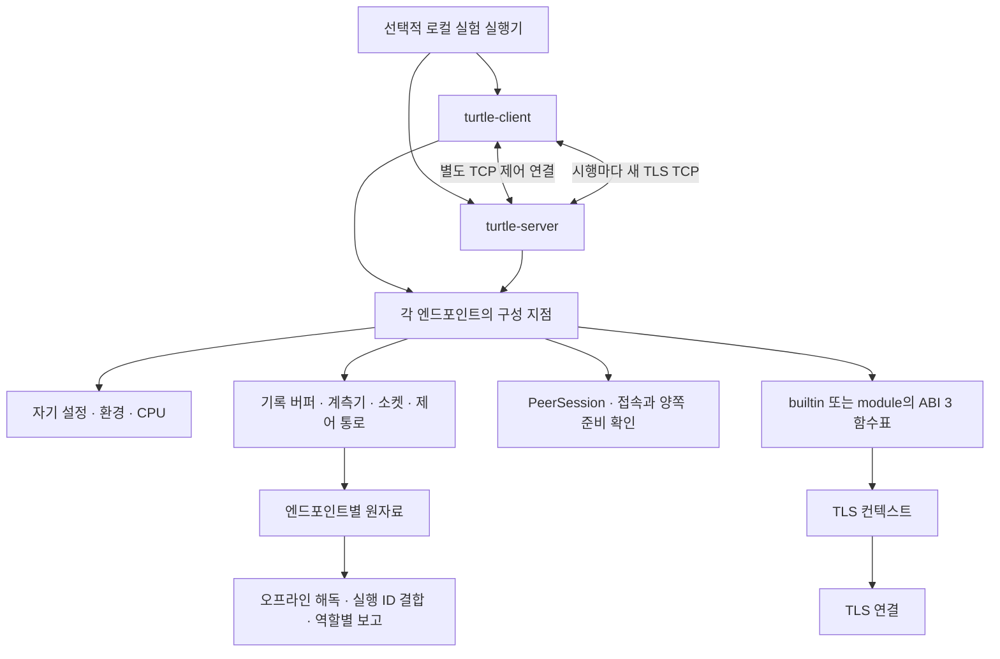

# 구조와 소유권

## 제어는 프레임워크에, TLS는 어댑터에 둡니다

SUPERCOP의 작은 구현 계약과 준비 단계 지원 확인, Spring의 명시적 의존성 전달과 생명주기 순서를 참고했습니다. 관찰한 소스와 적용 범위는 [결정 기록](../project/DECISIONS.md)에 남깁니다. C++20의 지역 객체와 RAII로 구현하며 전역 컨테이너나 서비스 조회기는 없습니다.

`endpoint.cpp`는 자기 주소·실행 식별·입력 상태와 `PeerSession`을 구성합니다. `peer_session.cpp`는 TCP 접속·수신 소켓의 수명과 양쪽 시험 준비 확인을 맡습니다. `role_runtime.cpp`는 전달받은 세션에 계측기·버퍼·어댑터·호스트 서비스를 연결하고 TLS 컨텍스트와 시행 루프를 소유합니다. `endpoint_protocol.cpp`는 직접 TCP 제어 프로토콜을, `lookup_runtime.cpp`는 선택적 조회 클라이언트와 독립 조회 서비스를 구현합니다. `scripts/run-local.py`가 새 프로세스 반복·로컬 CPU 배치·시도 원장·관측 경계를 소유합니다. 기존 `director.cpp`와 `turtle run` 경로는 제거했습니다.

`transport`는 계측기나 기록기에 직접 의존하지 않습니다. 역할 런타임이 비소유 관측 함수를 전달해 두 부품을 연결합니다. `measure`는 기록 형식을 모르며, `record`는 TLS 메시지를 해석하지 않습니다. 분석기는 측정 실행 파일에 링크하지 않습니다. 각 부품은 CMake 라이브러리 대상으로 나뉩니다.

## 수명과 상태

각 엔드포인트는 `main → 설정 → 수신 대기/제어 연결 → 지원·버퍼·컨텍스트 준비 → 시행별 TCP·TLS → 기록·완료` 순서로 실행합니다. 별도 빌드·작업·출력 폴더와 툴체인을 사용할 수 있으며 상대의 파일이나 CPU를 소유하지 않습니다.

소유 관계의 해제 순서는 `연결 → TLS 컨텍스트 → 호스트 서비스 → 어댑터 모듈 → 계측기·기록 버퍼 → 외부 소켓`입니다. 컨텍스트와 연결의 소멸 함수는 로드된 함수표가 살아 있는 동안 호출합니다. 소켓·관측 콜백·`HostServices`는 어댑터에 비소유로 전달합니다. 외부 C 할당 API가 사용자 인자를 받지 않을 때만 어댑터 안에 비소유 `thread_local` 연결 포인터를 두며, 그 제한과 이유는 각 구현 문서에 있습니다.

기본은 프로세스당 TLS 컨텍스트 하나와 측정 연결 하나입니다. `--warmups N --connections K`는 같은 컨텍스트의 준비 연결 N개와 측정 연결 K개이며 독립 표본 수는 늘리지 않습니다. 외부 실행기는 새 프로세스로 독립 반복을 수행하지만 호스트 캐시까지 초기화됐다는 뜻은 아닙니다. `builtin`은 선택한 어댑터 하나만 실행 파일에 연결하고 `module`은 명시한 공유 모듈을 엽니다. TLS 라이브러리 자체의 정적·동적 연결은 별도 출처 항목입니다.

엔드포인트만 빌드할 때 분석 도구를 끌 수 있고 클라이언트만 구성할 때 서버가 필요하지 않습니다. 분석 전용 구성은 어댑터 의존성을 찾지 않습니다. 교차 컴파일의 configure는 대상 바이너리를 실행하지 않으며 지원 여부는 대상 장비의 준비 단계에서 확인합니다.

## 측정 경로

라이브러리 호출 시작·완료, 송수신 진입·반환, 대기 시작·완료에서 스냅샷을 남깁니다. 실제 전송에 성공한 바이트만 방향별 스트림 위치를 증가시킵니다. 모든 TLS 메시지는 구현체가 만듭니다. 런타임은 특정 핸드셰이크 메시지 순서를 만들어 넣지 않습니다.

채널마다 관측자 하나를 선택적으로 연결하며, 함수형 계약은 `void (*)(void*, const Observation&) noexcept`입니다. 채널은 관측자 문맥을 소유하지 않으므로 그 문맥은 채널과 채널에서 빌린 `Io`보다 오래 살아야 합니다. 관측자는 사건과 성공한 바이트를 기록할 뿐 TLS 단계, 입출력 결과, 재시도나 제어 흐름을 결정하지 않으며 전달된 페이로드·채널·프로토콜 상태를 바꾸지 않습니다. 이는 관측 유무가 TLS의 논리 결과를 바꾸지 않는다는 계약이지 실행 비용이 없다는 뜻은 아닙니다.

`measurement.channel_observer=false`는 이 함수 포인터만 비웁니다. `Channel`·`Io`·소켓·버퍼·콜백 TLS 경로와 호출·대기 계측, 키 로그·평문 알림, 성능 카운터는 그대로입니다. 관측자 켬/끔 차이는 전체 계측 비용의 수학적 상한이나 하한이 아니며 서버의 계측 없는 기준선을 대신하지 않습니다.

호출·대기·I/O 진입 사건은 스냅샷 뒤 고정 버퍼에 추가합니다. I/O 반환 사건은 고정 공간 준비와 성공 스트림 복사를 먼저 하고, 스냅샷을 한 번 읽은 뒤 그 값을 준비한 공간에 넣습니다. 파일 출력, JSON 변환, 문자열을 돌려주는 협상 결과 조회는 주 구간 뒤에 둡니다. 라이브러리 자체의 정상 할당은 실행의 일부이며 메모리 모드에서 관측합니다.

시계와 카운터는 순차적으로 읽으므로 하나의 원자적 시각이 아닙니다. 현재 측정 계약은 I/O 반환 스트림 복사와 반환·`KernelRx` 고정 공간 준비를 스냅샷 앞에 두어 I/O로 분류합니다. 그래도 복합 계측 읽기, 스냅샷 뒤 공간 대입, 관측자 복귀 비용은 연산으로 분류한 토막에 섞일 수 있습니다. 여기서 연산은 입출력·대기 밖의 호출 구간이라는 운영상 분류이지 순수 암호 연산만의 비용이 아닙니다.

## 코드 읽기 순서

처음 읽을 때는 다음 순서가 실제 의존 방향을 따라가기 쉽습니다.

1. `include/turtle/adapter.hpp`: 코어와 TLS 구현체 사이의 공개 ABI와 소유권 계약
2. `src/config/config.*`: 명령행·프로필을 검증해 실행 설정으로 만드는 경계
3. `src/model/model.hpp`, `service.hpp`, `run_config.hpp`, `sample.hpp`: 이름, 실행 설정, 서비스와 표본 값
4. `src/lifecycle/endpoint.cpp`, `scripts/run-local.py`: 독립 구성 지점과 외부 반복의 책임 구분
5. `src/lifecycle/role_runtime.cpp`, `capture.hpp`: 한 TLS 역할의 연결 루프와 측정 캡처
6. `src/lifecycle/endpoint_protocol.*`, `lookup_runtime.*`: 직접 TCP 제어 메시지와 선택적인 합성 조회·모의 CA
7. `src/transport/`, `src/measure/`, `src/record/`: 비차단 I/O, 계측, 고정 버퍼와 원자료 출력
8. `src/interpret/`: 저장한 스트림과 키 로그의 오프라인 해독
9. `src/report/window.*`, `report.*`, `lookup_report.cpp`: 측정 구간, 일반 요약과 조회 요약
10. `implementations/`: OpenSSL·wolfSSL·Mbed TLS·mock 어댑터

`src/model/service.hpp`는 서비스 값을, `src/record/service.*`는 원자료 출력 서비스를 다룹니다. 이름이 비슷하지만 소유 책임이 다릅니다.

## 경계 검사와 테스트

`tests/`는 별도 CMake 프로젝트입니다. 부품 단독 시험 외에 실제 TCP를 쓰는 통합 시험이 있습니다. `scripts/check-modules.py`는 정적인 include 경계와 순환 의존을 검사합니다. 매크로로 만든 include나 CMake 링크 그래프 전체를 증명하는 도구는 아닙니다. 어댑터의 실제 컴파일 명령에도 내부 `src/` include 경로를 주지 않습니다.

새 기능은 먼저 한 책임의 부품에 넣습니다. 두 번째 구현이 없는 통로·계측 추상화나 범용 컨테이너, 서비스 탐색 계층을 미리 만들지 않습니다.
