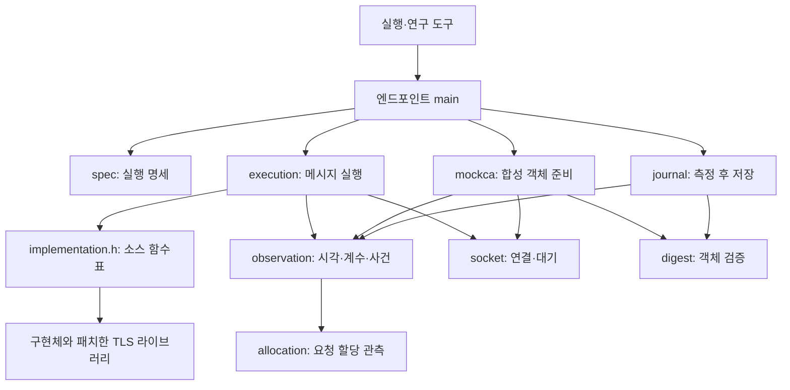
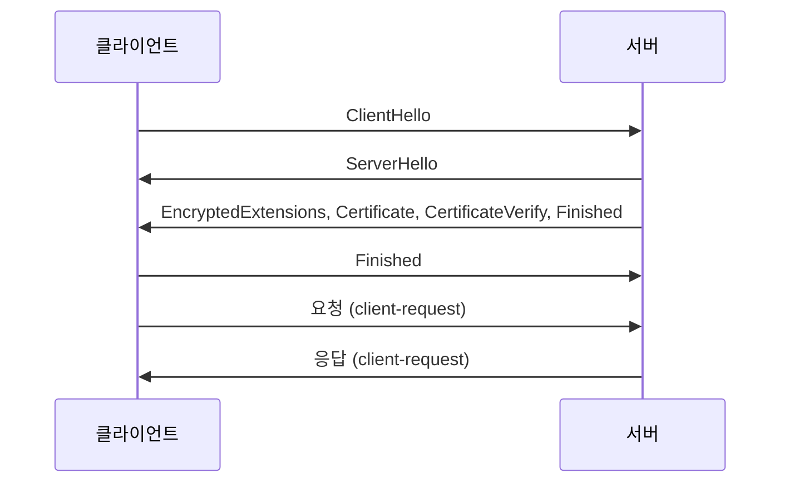
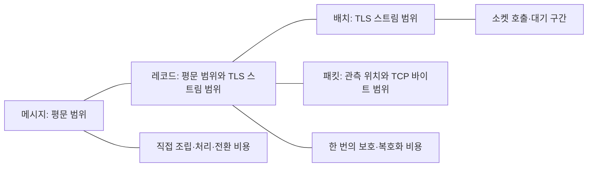

# TURTLE 프레임워크 설계

2026-11-16의 소스 계약과 실행 코드를 기준으로 작성했습니다. 이 문서는 현재 구현의 동작과 그 동작을 선택한 이유를 설명합니다. 다음 변경의 제안은 [설계 논의](discussion.md)에 따로 두었습니다. 실행 방법은 [README](../../README.md), 함수 구현 방법은 [구현자 안내](implementation-guide.md), 실제 실행 증거는 [검증 기록](../project/validation.md)을 참고합니다.

TURTLE의 비교 단위는 **프레임워크가 정한 순서와 전송 정책으로 실행한 인증서 기반 TLS 1.3 연결**입니다. 프레임워크가 논리 메시지의 생성·처리 호출, 레코드 분할·묶음, 소켓 제출과 수신, 측정 경계를 소유합니다. 구현체는 암호 연산과 라이브러리 내부 상태를 소유합니다. 이 분리로 같은 시나리오 안에서 구현체를 바꾸고, 기존 구현체의 메시지 함수 하나를 교체하는 연구를 할 수 있습니다.

이때 얻는 값은 TURTLE의 경계 패치와 실행 정책 아래에서 관측한 비용입니다. 수정하지 않은 라이브러리의 기본 handshake 루프나 실제 서비스의 연결 처리 성능과 같은 값으로 해석하지 않습니다. 공통 함수 이름을 사용한다고 해서 세 라이브러리 내부의 작업 분배까지 같아지는 것도 아닙니다.

## 1. 목적과 현재 실행 범위

현재 구조가 직접 답하려는 질문은 다음과 같습니다.

- 같은 인증·시나리오·전송 조건에서 엔드포인트의 준비, 프로토콜 실행, 첫 사용 비용은 어떻게 다른가.
- 차이가 메시지 조립·처리, transcript·키 전환, 레코드, I/O·대기 중 어느 관측 구간에서 나타나는가.
- 메시지 함수, KEM 실행 분기, 컨텍스트 캐시를 바꾸었을 때 실제 프로토콜 바이트와 인증 완료, 관측 비용이 함께 어떻게 달라지는가.
- 네트워크 설정과 외부 관측을 추가했을 때 기록된 바이트·사건·표본을 어디까지 연결할 수 있는가.

| 항목 | 현재 범위 |
|---|---|
| 프로토콜 | TLS 1.3의 인증서 기반 전체 핸드셰이크, 정상 경로 |
| 인증 | 서버 인증 또는 상호 인증 |
| 암호군·인증서 | `TLS_AES_128_GCM_SHA256`, P-256 ECDSA 시험 인증서 |
| 키 교환 | 기본 P-256, 별도 구현체의 ML-KEM-768 |
| 전송·플랫폼 | IPv4 TCP, 비차단 소켓과 `poll`, `TCP_NODELAY`; Linux 구현, 현재 검증은 x86_64 WSL2 |
| 역할·동시성 | 클라이언트·서버 각각 별도 프로세스, 프로세스당 컨텍스트 하나, 연결은 순차 실행 |
| 기본 실행 | `client-request`, black-box, 측정 연결 하나, 준비 연결 없음 |
| 제외한 경로 | 재개·PSK·0-RTT·티켓·HelloRetryRequest·post-handshake 인증과 임의 프로토콜 상태 그래프 |

강건성·공격·잘못된 인증서 거절·타이밍 누출 시험, 보안과 성능의 관계, 학회 적합성 판단은 범위 밖입니다. 지원하는 정상 경로를 완료하지 못하면 해당 실행을 무효로 남깁니다.

## 2. 서로 다른 실행 단위

| 단위 | 의미와 관계 |
|---|---|
| 논리 메시지 | ClientHello, Certificate, Finished와 응용 요청·응답. 조립·처리와 직접 전환 비용의 기준 |
| 레코드 | 한 번의 보호·복호화 단위. 메시지 하나가 여러 레코드에 걸칠 수 있고 여러 메시지가 한 레코드를 공유할 수 있음 |
| 출력 배치 | 실행기가 한 제출 구간에서 소켓에 전달하는 완성된 레코드들의 연결본 |
| 소켓 호출 | `send` 또는 `recv` 한 번. 부분 진행·재시도로 한 배치나 레코드에 여러 호출이 필요할 수 있음 |
| TCP 스트림 | 방향별 연속 바이트 위치. 레코드와 패킷을 연결하는 기준 |
| 패킷 | 특정 관측 위치에서 수집한 TCP 바이트 범위. 분할·중복 관측·재전송 때문에 레코드와 일대일 대응하지 않음 |

`finished-ping`은 서버 Finished 레코드와 Ping 레코드를 같은 출력 배치에 넣는 조건입니다. 서로 다른 보호 키를 사용하는 두 레코드를 하나로 합치지 않습니다. 한 번의 `send`, 한 TCP 세그먼트, 한 번의 물리 송신을 보장하지도 않습니다.

이 구분은 비용 귀속의 기준이기도 합니다. 공유 레코드의 암호화 비용은 레코드에 한 번 기록하고 관련 메시지들을 연결합니다. 메시지별 비용을 보기 좋게 만들기 위해 공유 비용을 나누거나 복제하지 않습니다.

## 3. 부품과 소유권



도표의 화살표는 주요 호출·자료 의존을 나타냅니다. 소유권은 아래 표와 같습니다. 실제 `send/recv` 호출은 `Execution`에 있고, `socket` 부품은 소켓의 생성·접속·수락·대기와 제어·조회용 전체 바이트 전송을 담당합니다.

| 소유자 | 소유하는 상태 | 빌려 쓰는 상태 |
|---|---|---|
| 엔드포인트 | `Spec`, `Observer`, 데이터·제어 소켓, 조회 객체 캐시, 구현체 컨텍스트와 현재 연결의 수명 | 정적으로 연결한 함수표 |
| 구현체 컨텍스트 | 자격 증명, 라이브러리 설정·난수 상태, BiTHaC 기법 캐시 | 생성 옵션에서 참조한 문자열 |
| 구현체 연결 | TLS 상태, transcript·키·시퀀스, 구현체 메시지·레코드 버퍼 | 자기 컨텍스트 |
| `Execution` | 연결별 조립·재조립·레코드·출력 배치·선택적 캡처 버퍼와 ID 계수 | 명세, 함수표, 구현체 연결, 관측자, 소켓 FD |
| `Observer` | 사건 배열, PMU FD, 요청 할당 추적 표 | 현재 스레드의 시계·계수 읽기 |
| 외부 관측 도구 | 소유 네임스페이스·관측 프로세스·FD·원본 자료 | 실행 명세와 엔드포인트 산출물의 식별자 |

공개 구현자 계약은 [implementation.h](../../include/turtle/implementation.h) 하나입니다. 구현체는 프레임워크 내부 헤더를 포함하지 않고 소켓·네트워크 콜백·시계·계측기를 받지 않습니다. `create_*`가 반환한 핸들은 대응하는 `destroy_*`로 정리합니다. 컨텍스트가 연결보다 오래 살아야 합니다. 현재 엔드포인트는 옵션 문자열도 컨텍스트 수명보다 오래 유지합니다. 함수 호출의 바이트 뷰는 호출 동안만 빌려 쓰므로 구현체가 나중에 필요로 하면 자기 상태에 복사해야 합니다.

일반 TLS 라이브러리의 전역 런타임 초기화는 남아 있을 수 있습니다. TURTLE의 설정·관측자와 BiTHaC 기법 캐시의 소유권을 전역에 두지 않는다는 원칙과 구별합니다. C 할당 API는 사용자 인자를 받지 않으므로 할당 어댑터에만 비소유 thread-local 포인터를 두고, `AllocationScope` 종료 시 이전 포인터로 복원합니다.

근거: [엔드포인트](../../src/endpoint/main.cpp), [실행기 선언](../../src/execution/execution.hpp), [관측자](../../src/observation/observation.hpp), [할당 어댑터](../../src/allocation/allocation.cpp).

## 4. 엔드포인트 수명과 제어 경로

엔드포인트는 실행 명세를 읽고 출력 위치를 준비한 다음 관측자를 만듭니다. 서버는 데이터·제어 수신 소켓을 열고 `ready` 파일을 남깁니다. 양쪽은 선택적 MockCA 준비와 구현체 컨텍스트 생성을 마친 뒤 제어 연결에서 공유 조건을 대조합니다. `ready`는 포트를 열었다는 표시이며 인증이나 컨텍스트 준비 완료의 증거가 아닙니다.

각 반복에서는 새 TCP 연결, 새 구현체 연결, 새 `Execution`을 만듭니다. 시나리오가 성공하면 저장 공간을 조회하고 선택적 스트림과 연결 결과를 저장합니다. 구현체 연결을 정리한 뒤 제어 연결로 상대의 해당 연결 완료를 확인합니다. 모든 반복이 끝나면 컨텍스트를 정리하고 사건·manifest를 저장합니다. 준비 연결도 실제 전체 프로토콜을 수행하며, 같은 컨텍스트를 사용한다는 점에서 뒤 연결에 영향을 줄 수 있습니다.

제어 계약은 run ID, 시나리오, 인증, 그룹, 연결·준비 연결 수와 응용 크기를 대조합니다. 레코드 정책과 계측 설정을 양쪽에서 같게 강제하지는 않습니다. 양쪽 설정을 달리한 연구가 가능하므로 그 조건은 각 역할의 명세와 결과로 해석해야 합니다. `external_peer`에서는 제어 연결을 생략합니다.

컨텍스트가 살아 있는 동안 연결 객체는 새로 만들어집니다. 따라서 반복 연결은 TLS 세션 재개가 아니며 컨텍스트 준비·일반 라이브러리 상태·기법 캐시의 재사용을 관측합니다. 기본 독립 표본은 새로운 프로세스에서 이 수명을 다시 시작합니다.

## 5. 메시지 실행 계약

공통 실행기의 네 작업은 조립, 송신을 위한 레코드 보호, 수신 레코드 복호화, 메시지 처리입니다. 이 네 작업 사이의 transcript·키·캐시 후처리는 `transition`으로 드러냅니다. 소켓 제출은 구현체의 레코드 보호와 별도로 실행합니다.

| 함수·전환 | 입력과 책임 | 실행기가 요구하는 완료 조건 |
|---|---|---|
| `BEGIN` | 연결 프로토콜 초기화 | 다음 메시지나 네트워크 진행 없이 반환 |
| `PREPARE_SEND` | 지정 메시지 선택과 사전 작업 | 해당 메시지를 조립할 상태 |
| `assemble` | 메시지 종류, 메시지 내부 offset, 출력 버퍼 | 양의 생산량, 소비량 0, 마지막 조각에서 `DONE` |
| `COMMIT_SEND` | 완성된 메시지 바이트 | transcript·후처리·필요한 키 전환 완료 |
| `protect` | 레코드 내용 종류와 평문 범위 | 입력 전체 소비, 5바이트 헤더를 포함한 한 레코드 생산, `DONE` |
| `unprotect` | 완성된 레코드 | 입력 전체 소비, 인증 복호화된 평문과 내용 종류, `DONE` |
| `PREPARE_RECEIVE` | 재조립한 메시지 전체 | 해당 메시지의 검증·transcript 순서 준비 |
| `process` | 메시지 조각과 마지막 범위 표지 | 양의 소비량, 생산량 0, 메시지 전체 소비 때만 `DONE` |
| `COMMIT_RECEIVE` | 완성된 수신 메시지 | 처리 후 작업·키 전환 완료 |
| `FINISH` | 로컬 핸드셰이크 종료 | 종료 후처리와 기법 캐시 갱신 완료 |
| `result` / `storage` | 성공 증거 / 저장 공간 조회 | 실제 전체 인증 증거 / 가용 비트가 있는 항목만 제공 |

`MORE`는 소켓 대기나 비동기 재개 요청이 아닙니다. 조립·처리의 바이트 진행을 뜻합니다. 현재 계약에는 `NEED_IO`, 비동기 연산 핸들, 타이머 요청이 없습니다. `process`가 마지막으로 제시된 범위의 일부만 소비하면 남은 범위에도 마지막 표지가 다시 전달될 수 있습니다. 완료 판정은 실제 누적 소비량을 기준으로 합니다.

일반적인 송신은 `PREPARE_SEND → assemble* → protect* → COMMIT_SEND`입니다. 다만 묶음 정책에서는 앞 메시지의 transcript를 갱신해야 다음 메시지를 조립할 수 있으므로 `COMMIT_SEND`가 아직 채우는 레코드의 보호보다 먼저 올 수 있습니다. 이를 허용하는 전제는 다음 절의 키 전환 경계입니다.

수신은 `소켓 읽기 → 레코드 수집 → unprotect → 메시지 재조립 → PREPARE_RECEIVE → process* → COMMIT_RECEIVE`입니다. 실제 라이브러리 파서는 마지막 조각에서 한 번 실행할 수 있습니다. 조각을 제공하는 인터페이스와 native 파서의 점진 처리는 같은 기능이 아닙니다.

TLS 1.3 상호운용용 CCS 레코드는 실행기에서 별도로 처리합니다. native `unprotect`를 호출하지 않고 메시지 평문·transcript·키 전환에 넣지 않습니다. 일반 handshake·응용 레코드의 암복호화 경로와 구별합니다.

응용 메시지의 결정적 바이트 생성·검증은 현재 `Execution`이 담당합니다. 이 비용도 `assemble/process` 사건으로 남기지만 구현체의 handshake 조립·처리 함수를 호출하지 않습니다. 구현체는 응용 데이터의 실제 레코드 암복호화를 수행합니다.

## 6. Transcript, 보호 단계와 제출 정책

송신 transcript는 실제 조립을 마친 메시지 바이트로 진행합니다. ClientHello 교체 예제에서도 교체 후 바이트를 commit에 넘깁니다. 수신 transcript 갱신과 Finished 검증 준비의 정확한 순서는 라이브러리별 경계 함수가 담당합니다. 공통 실행기가 native 내부 상태를 추측해 직접 수정하지 않습니다.

현재 실행기는 ClientHello·ServerHello·Finished에서 남은 평문을 반드시 보호한 뒤 commit합니다. 특히 ServerHello 자체는 평문 레코드로, Finished 자체는 handshake 키로 보호한 뒤 후속 보호 상태로 넘어가야 합니다. 이 경계는 현재 TLS 1.3 순서에 맞춰 코드에 명시되어 있습니다. 임의의 새 키 전환 메시지를 자동 발견하는 기능은 없습니다.

| 정책 | 결정하는 것 |
|---|---|
| `preserve` | 각 handshake 메시지의 끝에서 평문 레코드를 마침. 큰 메시지만 분할 |
| `bundle` | 같은 보호 단계의 후속 handshake 메시지를 남은 레코드 공간에 넣음 |
| `flight` | 상대 입력이 필요한 지점까지 출력 배치를 유지한 뒤 제출. 시나리오가 정한 Ping 제출 경계도 지킴 |
| `server-hello-first` | ServerHello를 보호·commit한 직후 그 배치를 제출 |

응용 데이터는 handshake 레코드에 합치지 않습니다. 배치는 완성된 레코드의 소유 버퍼입니다. `send`가 일부만 수락하면 바이트 위치만 진행합니다. `EAGAIN`에서는 소켓 준비를 기다리고, 제출을 재개할 때 이미 만든 암호문을 그대로 사용합니다. 제출 대기 때문에 조립이나 보호 함수를 다시 호출하지 않습니다.

## 7. 시나리오와 역할별 완료

서버 인증의 기본 순서는 다음과 같습니다. 상호 인증에서는 서버 EncryptedExtensions 뒤 CertificateRequest, 클라이언트 Finished 앞 Certificate·CertificateVerify를 추가합니다.



도표의 화살표는 논리적 전송 관계이며 레코드·배치·패킷 수를 나타내지 않습니다.

| 시나리오 | 서버의 추가 동작 | 클라이언트의 추가 동작 | 역할별 필수 완료 |
|---|---|---|---|
| `handshake` | 클라이언트 Finished 수신·처리 | 자기 Finished 제출 | 로컬 종료 후처리와 필요한 상대 인증 증거 확인 |
| `server-ping` | 서버 Finished 배치를 먼저 제출하고 별도 배치로 Ping 제출 | 자기 Finished 제출·종료 후 Ping 검증, Pong 제출 | 서버는 클라이언트 인증·Finished와 Pong 검증까지, 클라이언트는 Pong 제출까지 |
| `finished-ping` | 서버 Finished와 Ping 레코드를 같은 배치로 제출 | `server-ping`과 같은 수신·응답 순서 | 위와 같음 |
| `client-request` | 클라이언트 Finished·요청 처리 후 응답 제출 | 자기 Finished 제출·종료 후 요청 제출, 응답 검증 | 서버는 응답 제출까지, 클라이언트는 응답 검증까지 |

서버의 Ping은 클라이언트 Finished를 받기 전에 제출할 수 있습니다. 상호 인증에서도 서버의 시나리오는 이후 클라이언트 인증과 Pong 검증을 마쳐야 성공합니다. 양쪽의 종료 시각이 같은 사건을 가리키지 않으므로 역할별 비용을 따로 보고합니다.

완료의 송신 쪽 의미는 소켓 제출 완료입니다. 상대가 받았거나 TCP ACK가 도착했다는 뜻이 아닙니다. 상대 완료를 기다리는 제어 교환은 측정 구간 밖입니다.

## 8. 버퍼와 조각 처리의 실제 범위

프레임워크 버퍼는 연결 준비에서 확보합니다. 아래에서 `M`은 `max_message`입니다.

| 버퍼 | 현재 용량과 수명 |
|---|---|
| 조립 메시지 | `M`, 연결별 |
| 출력 배치 | `2M + 65536`, 연결별 |
| 보호 레코드·복호화 결과 | 각각 18432바이트, 연결별 |
| 수신 메시지 재조립 | `M + 18432`, 연결별 |
| 묶음 대기 평문 | 16384바이트, 연결별 |
| 선택적 스트림 4개 | 각각 출력 배치 용량의 두 배를 예약, 연결별 |
| 사건 배열 | `event_capacity`개를 관측자 생성 때 예약, 컨텍스트 수명 |
| 요청 할당 표 | 관측을 켜면 262144개 항목, 관측자 소유 |

조립·처리 함수에는 최대 4096바이트를 제시합니다. 현재 송신기는 전체 논리 메시지를 조립한 뒤 레코드로 나누고, 수신기는 전체 논리 메시지를 재조립한 뒤 처리 함수를 호출합니다. 따라서 큰 메시지를 지원하지만 네트워크 도착과 native 파싱을 겹치는 스트리밍 실행기는 아닙니다. 구현체가 별도의 완성 메시지 버퍼를 사용하면 복사와 저장 공간이 추가됩니다.

`max_message`, `record_size`, 응용 크기, 사건 용량에는 각각 상한·하한 검사가 있습니다. 그러나 모든 설정 조합의 출력 배치·캡처·사건 수가 사전에 계산되는 것은 아닙니다. 작은 레코드를 매우 많이 만들면 메시지가 `M` 안에 들어가더라도 다른 예약 용량이 먼저 부족할 수 있습니다. 현재는 실행 중 명시적인 용량 오류로 중단합니다. 측정 중 자동 증설로 성공시키지 않습니다.

이 표는 프레임워크의 요청 저장 공간입니다. 구현체 버퍼·기법 캐시는 측정 뒤 `storage()`로 별도 조회합니다. OpenSSL의 전체 native 레코드 버퍼 inventory는 미지원입니다. 어느 합도 RSS나 구현체 전체 메모리 사용량이라고 부르지 않습니다.

## 9. 측정 경계와 비용 모델

Black-box와 white-box는 [같은 `Execution`](../../src/execution/execution.cpp)을 사용합니다. Black-box는 준비·연결·시나리오 전체를 기록하고, white-box는 상세 사건의 시각·계수 읽기와 저장을 추가합니다. 관측 깊이가 같지 않은 실행의 수치를 같은 계측 조건으로 취급하지 않습니다.

역할 하나에 대해 준비 합계 `P`, 연결 `i`의 TCP 준비 `T_i`, 연결 준비 `C_i`, 프로토콜 비용 `S_i`를 다음처럼 정의합니다.

```text
P   = 프레임워크 준비 + 수신 소켓 준비 + 조회 준비 + 컨텍스트 준비
S_i = 시나리오 종료 시각 - 시나리오 진입 시각
F_1 = P + T_1 + C_1 + S_1
```

`F_1`이 첫 사용 비용입니다. 프로세스 기동부터 종료까지의 시간이 아니며, 서로 분리해 측정한 구간들의 합입니다. 서버 수신 소켓 준비는 생성·설정·bind/listen입니다. 클라이언트에는 이 소켓이 없으므로 해당 비용은 실제 0입니다. 조회를 사용하지 않은 경우도 조회 준비 비용은 0입니다. 필요한 사건이나 값이 누락되면 합계는 null입니다.

| 구간 | 포함 | 포함하지 않음 |
|---|---|---|
| 프레임워크 준비 | 사건 배열, 할당 표, 관측자·PMU 준비 | 명세 해석, 실행 파일 로딩, 출력 디렉터리 준비 |
| 컨텍스트 준비 | 역할·인증에 필요한 자격 증명, 구현체 설정·캐시 초기화 | 연결별 상태·TCP |
| TCP 준비 | 데이터 connect/accept와 그 대기 | 제어 교환 |
| 연결 준비 | 구현체 연결 생성, `Execution`의 예약 버퍼 준비 | `BEGIN` 이후 프로토콜 작업 |
| 시나리오 | `BEGIN`부터 로컬 필수 송신·수신·처리·검증 완료, `FINISH`, 서버 첫 TLS 읽기 전 대기 | 사후 저장, inventory 조회, 연결·컨텍스트 파괴, 상대 완료 제어 대기 |

준비 연결이 있으면 실제 첫 준비 연결에 `F_1`이 붙습니다. 첫 측정 연결로 이 비용을 옮기지 않습니다. 이후 연결의 `first_use_ns`는 null이며 컨텍스트 준비를 복제하거나 상각하지 않습니다. 서버 인증의 클라이언트는 신뢰 CA만, 서버는 자기 인증서·키만 준비하고 상호 인증에서는 양쪽 모두 준비합니다.

상세 경과 시간에서는 전환·조립·처리·보호·복호화·송수신·대기의 겹치지 않는 구간만 더합니다.

```text
framework_remaining = S_i - 상세 구간들의 합
```

이 잔여값에는 버퍼 복사, 실행 제어, 메시지 경계 확인, 계측·기록의 일부 비용과 별도 구간으로 감싸지 않은 결과 확인 등이 포함됩니다. 이를 순수한 프레임워크 함수 시간이나 계측 오버헤드의 정확한 추정치로 해석하지 않습니다. `batch`와 `scenario`는 부모 구간이므로 하위 `send/wait`나 메시지별 비용에 다시 더하지 않습니다. 현재 응용 바이트 검증은 `process`에 포함되며, 사건 종류에 `verify`가 있다고 해서 모든 검증이 별도의 그 사건으로 기록되는 것은 아닙니다.

각 구현체 호출의 측정 구간에는 경계 호출과 할당 관측 범위 진입·복원 비용도 포함됩니다. 라이브러리의 순수 암호 함수 시간이라고 부르지 않습니다. `BEGIN` 안에서 발생하는 native 초기 할당은 시나리오 비용입니다. 모든 라이브러리의 할당을 프레임워크 연결 준비로 옮겼다고 가정하지 않습니다.

## 10. 관측 수단과 가용성

| 수단 | 기록하는 값 | 해석의 경계 |
|---|---|---|
| 경과 시간 | `CLOCK_MONOTONIC` 정수 ns | 대기·스케줄링을 포함한 로컬 구간 |
| 스레드 CPU | `CLOCK_THREAD_CPUTIME_ID` 정수 ns | 해당 스레드의 CPU 시간, 엔드포인트 밖 관측기 비용과 별개 |
| PMU | user-thread cycles·instructions, time_enabled/time_running | 원계수 보존, 다중화 보정값이나 정확한 함수 시간으로 자동 환산하지 않음 |
| 요청 할당 | live·누적 할당/해제·횟수·수명 peak | 정적 malloc 계열 경로의 구현체 호출 범위, RSS·스택·allocator 관리 공간·숨은 libc 할당 제외 |
| 스트림 | 소켓 제출·수신 바이트와 보호 입력·인증 복호화 출력 | 시나리오 안의 메모리 복사 부담, 파일 저장은 시나리오 밖 |
| 패킷·커널 | 위치·시계가 명시된 패킷과 커널 사건 | 외부 수집의 누락·부담·환경 지원을 별도로 확인 |
| CPU 표본 | 별도 perf 실행의 sample count·period 비중 | 정확한 호출 시간·횟수·전체 CPU 시간으로 바꾸지 않음 |

시각·CPU·PMU는 한 하드웨어 명령으로 동시에 읽히지 않습니다. 같은 호출의 여러 계측값에도 읽기 순서가 있습니다. 클라이언트·서버·MockCA의 절대 시각을 빼서 하나의 프로토콜 비용을 만들지 않습니다. 같은 호스트의 perf 표본을 자기 엔드포인트의 단조 시계 구간에 대응하는 것은 별도의 명시적인 관측 관계입니다.

`available`, `not-collected`, `unsupported`, `missing`을 구분하고 미관측 수치는 null로 둡니다. 할당 표가 부족하면 `missing`입니다. 할당 peak는 관측 수명의 최고값이므로 두 스냅샷의 peak 차이를 해당 구간의 peak로 쓰지 않습니다. 할당을 꺼도 링크 래퍼의 활성 여부 분기는 남습니다.

## 11. 사건·출처·보고서 모델

실행 명세, 제어, 사건, manifest와 보고서는 각각 `turtle-message-…/1` 계약 문자열을 사용합니다. 구형 형식을 추측해 읽지 않습니다. `run.py`의 launch에는 실행 바이너리 해시와 인자·종료 코드가 있고, 빌드 manifest에는 소스·패치·컴파일 명령·라이브러리·바이너리 출처가 있습니다.

`context_id`는 현재 `run_id/client` 또는 `run_id/server`입니다. 연결 ID는 컨텍스트 안의 실행 순서입니다. 메시지·레코드 ID는 송신자별 순서이고 서버 송신에는 상위 32비트 표시를 붙입니다. 따라서 양쪽 기록을 연결할 때는 같은 run·connection과 송신자 방향·메시지 또는 레코드 ID를 사용합니다. 양쪽의 로컬 `context_id`가 같을 것을 요구하지 않습니다. 배치 ID는 로컬 송신자에만 있으며 수신 기록에서 상대 배치를 추정하지 않습니다.



메시지↔레코드는 평문 범위의 교집합, 레코드↔패킷은 방향별 스트림 범위로 연결합니다. 연결선은 관계이며 비용의 추가 복사본이 아닙니다. `message/record` 관계 사건의 시각은 null입니다.

현재 사건의 필드 이름에는 문맥 의존성이 있습니다. `stream_offset/bytes`는 레코드·소켓·배치에서는 스트림 위치지만 `assemble/process`에서는 메시지 내부 조각 위치입니다. `type`도 메시지 종류와 레코드 내용 종류를 사건에 따라 담습니다. 암호화된 handshake 레코드의 wire 바깥 종류와 복호화 후 내용 종류도 구별해야 합니다. 해석 시 `kind`를 먼저 확인합니다. 정확한 필드 의미는 [자료 계약](../analysis/record-format.md)에 있습니다.

사건은 예약 메모리에 모았다가 JSONL로 저장합니다. 정상적인 예외 경로는 무효 이유와 이미 남은 사건을 저장하지만, 관측자 생성 이전의 실패나 프로세스 강제 종료까지 완전한 사건 파일을 보장하지는 않습니다. 실패한 시나리오의 스트림 파일도 성공 경로처럼 저장된다고 가정할 수 없습니다. 실행기의 launch·로그·산출물 누락을 함께 확인합니다. 현재 보고서는 한 엔드포인트나 상대가 실패하면 그 실행 쌍을 성공 표본에 넣지 않습니다.

## 12. 통계와 비교 조건

독립 단위는 새로운 프로세스·컨텍스트입니다. 같은 컨텍스트의 세 연결을 독립 표본 세 개로 늘리지 않습니다. 연결 위치별 분포와 컨텍스트 내부 측정 연결들에서 만든 대표값 분포는 별도입니다. 준비 연결과 실패한 실행은 성공 분포에서 제외합니다.

실행 순서는 배치 안에서 seed로 섞어 실행 전에 저장합니다. StQ1·StQ2·StQ3는 경험 분포의 지정 순위 구간 평균이며 경계 값에는 분수 가중치를 적용합니다. 자동 비교는 같은 배치·상대·역할·연결 위치·기록된 조건끼리 고정 위치의 컨텍스트를 재표집해 StQ2 차이의 탐색 구간을 만듭니다. 여러 연결 위치를 함께 재표집한 공동 곡선이나 인과 효과 추정은 구현하지 않았습니다.

현재 비교 키에는 시나리오·인증·그룹·깊이·레코드/제출 정책·레코드 크기·연결 수·응용 크기·관측 상태·조회·자격 증명·네트워크 조건 등이 들어갑니다. 그러나 **빌드·바이너리 해시, `io_chunk`, 메시지·사건 용량, 완전한 호스트 실행 환경과 외부 수집 보고서의 판정까지 자동 대조하지는 않습니다.** 이 정보 일부는 명세·출처 파일에 있어 수동 대조할 수 있지만 비교 키와 같은 것은 아닙니다. `exploratory` 상태를 모든 연구 조건이 통제되었다는 인증으로 읽지 않습니다.

상대 바이너리를 고정한 비교와 양쪽 구현체를 함께 바꾸는 self-pair는 다른 실험입니다. 현재 도구는 상대 구현체 이름을 조건에 넣지만 이름이 같고 바이너리가 다른 경우까지 자동 구별하지 못합니다. 비교 조건의 완전성은 다음 논의에서 먼저 다룰 항목입니다. 계산과 현재 제외 규칙은 [보고서 설명](../analysis/reporting.md), 근거 코드는 [report.py](../../scripts/report.py)입니다.

## 13. 라이브러리 경계와 연구 기능

| 구현체 | 연결 방식과 경계 |
|---|---|
| OpenSSL 3.5.4 | private statem의 단일 메시지 생성·처리와 명시적 pre/post 작업, record 메서드. 메모리 BIO는 내부 바이트 전달용 |
| Mbed TLS 3.6.4 | 패치로 노출한 본문 생성·파싱·후처리 경계와 native 레코드 암복호화 |
| wolfSSL 5.8.2 기반 | 단일 메시지 함수의 출력 수집, 내부 송신·transcript·키 전환 경계 분리, `TurtleWolfBuild/Process/Commit` |
| ML-KEM C·AVX2 | 같은 wolfSSL 기반과 메시지 실행 경로. 두 연산 번역 단위의 실행 분기 차이와 실제 KEM 완료 수 확인 |
| BiTHaC baseline·cached | 같은 저자 코드 기반. CI·SSC 캐시를 컨텍스트가 소유하고 `FINISH` 후처리에 갱신 연결 |

기본 라이브러리 사이의 비교와 같은 기반 안의 기법 비교는 분리합니다. BiTHaC의 기반이 현재 기본 wolfSSL과 같다고 가정하지 않습니다. 구체적인 커밋과 패치는 [의존성 빌드 도구](../../scripts/dependencies.py)와 각 빌드 manifest에 고정합니다.

ML-KEM 결과는 실제 keygen·encapsulate·decapsulate와 내부 최적화 분기 횟수입니다. 분기 횟수를 KEM 호출 수로 바꾸지 않습니다. BiTHaC 결과는 최초 빈 캐시, 뒤 연결의 실제 메시지·cache hit, 전체 인증 완료를 함께 확인합니다. 캐시를 지원하지 않는 상대와의 성공은 캐시 기법 사용 성공과 구별합니다.

MockCA는 합성 바이트 객체를 제공하는 독립 서비스입니다. 엔드포인트가 조회 또는 고정 저장본 읽기, digest 검증, 소유 캐시 삽입을 마친 뒤 같은 TLS 실행기로 들어갑니다. 객체는 TLS 인증서의 대체물이 아니며 실제 발급·OCSP·ACME 구현도 아닙니다. 서비스 비용과 엔드포인트의 조회 준비 비용을 더해 단일 시계의 값으로 만들지 않습니다.

netem은 소유 네임스페이스의 방향별 경로에 적용하고 qdisc·경로·초기 cwnd·offload를 다시 읽습니다. TLS·조회·제어 흐름을 구별하며 지정 제거, qdisc 제거, 실제 TCP 재전송은 서로 다른 사건입니다. 현재 패킷 시각은 위치가 명시된 커널 skb 또는 사용자 공간 관측 시각이며 NIC 하드웨어 시각이 아닙니다. 자세한 범위는 [네트워크 관측](../analysis/network.md)에 있습니다.

CPU 표본은 별도 실행에서 perf.data와 당시 바이너리·심볼 출처를 보존합니다. 겹치는 부모·자식 측정 구간은 별도 보기입니다. 가상 객체·심볼 미확인, 표본이 없는 짧은 구간, 수집 부담을 보존하며 정확한 함수 시간으로 환산하지 않습니다. [CPU 표본 설명](../analysis/cpu-profiling.md)에 수집과 재분석 조건이 있습니다.

## 14. 빌드, 자료 수명과 검증

C++20 코어와 C 소스 구현체를 CMake·Ninja로 함께 컴파일합니다. [공통 등록 함수](../../cmake/Implementation.cmake)가 구현체별 클라이언트·서버를 만듭니다. 바이너리 플러그인 ABI와 실행 중 모듈 선택은 제공하지 않습니다. 구현체를 새로 추가할 때는 공개 헤더와 자기 CMake 등록을 사용합니다. 현재 메시지 순서 안에서 함수 교체는 코어·관측·보고서를 바꾸지 않고 가능하지만, 새로운 상태 순서나 새로운 전용 결과 필드를 도입하는 변경까지 그 방식으로 해결되는 것은 아닙니다.

활성 빌드는 `build-message`, 시험 빌드는 `build-message-tests`, 현재 native 의존성은 `.deps-message`입니다. `.deps`에는 오프라인 원본과 필요한 도구만 둡니다. 과거 빌드의 검증 자료는 `artifacts/build-history`에, 실행 자료는 `results`에 보존합니다. 과거 CMake 경로를 현재 빌드처럼 사용하는 별칭은 없습니다. 세부 보존 규칙과 정리 내역은 [작업 공간 관리](../project/workspace.md)에 있습니다.

| 검증 층 | 확인하는 것 | 그 검증만으로 확정할 수 없는 것 |
|---|---|---|
| 결정적 구현 | 단계·키 전환·진행·부분 I/O·범위·비중첩 | 실제 TLS 인증·암호화 성공 |
| 세 라이브러리와 외부 TLS | 전체 인증, 응용 검증, 실제 바이트 대응, 정책 조합 | 임의 프로토콜 경로나 모든 외부 TLS 설정 |
| 연구 기능 실행 | 실제 KEM·캐시·조회·관측 증거 | 다른 기법의 성능이나 일반적인 성능 우열 |
| 정적 검사 | 직접 호출 금지 패턴, 부품 방향, 컴파일 옵션의 진단 | native 라이브러리 전체 호출 그래프의 정형 증명 |
| 오프라인 새 빌드 | 고정 원본·패치에서 빌드·실행·분석 가능 | 다른 CPU·커널·운영체제에서의 동일 성능 |

검증 성공, 관측 가용성, 비교 적격성은 서로 다른 판정입니다. 현재 구현에 대한 구체적인 증거와 WSL 환경의 한계는 검증 기록에 남기고, 그 기록을 미구현 범위나 더 높은 측정 정확성의 근거로 확대하지 않습니다.
