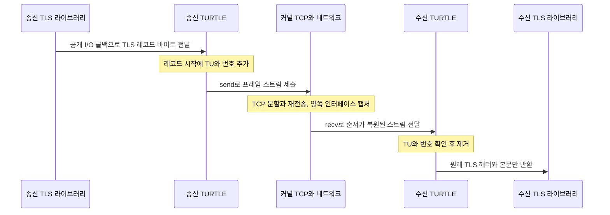
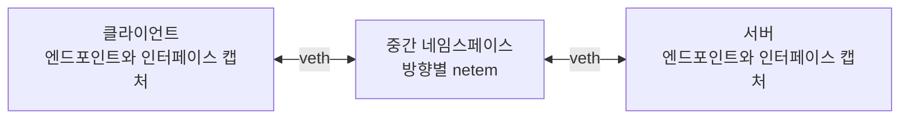

# TURTLE 설계와 레코드 프레임 기반 측정 방법론

TURTLE은 인증서 기반 TLS 1.3 전체 핸드셰이크와 암호화된 응용 교환을 실행하고, 클라이언트와 서버의 비용을 공개 호출·TLS 레코드·TCP 바이트 범위에 연결하는 벤치마크 프레임워크다.

핵심 방법은 **TLS 라이브러리가 전송하려는 레코드 바이트에 방향별 식별 프레임을 붙이고, 상대 라이브러리에 전달하기 전에 제거하는 것**이다. 프레임은 실제 TCP 데이터에 포함된다. 엔드포인트에서 기록한 사건과 바이트 범위를 pcap의 TCP 시퀀스 범위에 대응시켜, 어떤 공개 호출과 레코드가 어떤 패킷·재전송 바이트에 연결되는지 분석한다.

프레임의 단위는 TLS 레코드다. TCP 패킷마다 헤더를 붙이지 않는다. 패킷 분할과 재전송은 커널 TCP가 수행하며, TURTLE은 그 결과를 바이트 범위로 관측한다.

## 1. 목적과 관측 단위

연구자는 TLS 소스·설치 라이브러리·컴파일 옵션·설정·연산 구현을 제공한다. TURTLE은 같은 실행 순서와 계측 경계에서 준비, 핸드셰이크, 암호화된 `ping`·`pong`을 수행한다. 라이브러리 내부 수정, 핸드셰이크 메시지 콜백, 암호화된 메시지의 복호화는 요구하지 않는다.

현재 실행 범위는 Linux의 IPv4 TCP, 블로킹 I/O, TLS 1.3 전체 핸드셰이크와 서버 인증이다. 양쪽 모두 TURTLE 전송 계층을 사용한다. 한 시도마다 새 클라이언트·서버 프로세스를 실행하며, 각 프로세스는 컨텍스트 하나와 측정 연결 하나를 사용한다.

| 단위 | 의미 |
|---|---|
| 구성 | 비교할 실행 파일·구현체 설정·계측 옵션·네트워크 조건의 조합 |
| 시도 | 한 구성을 새 클라이언트·서버 프로세스로 한 번 실행한 것 |
| 엔드포인트 | 클라이언트 또는 서버 역할의 실행 주체 |
| 공개 호출 | `prepare`, `handshake`, `read`, `write`, `shutdown` 같은 실행 계약의 호출 |
| 전송 콜백 | TLS 라이브러리가 원래 TLS 바이트를 주고받기 위해 호출한 TURTLE 전송 함수 |
| TLS 레코드 | TLS의 5바이트 외부 헤더와 그 헤더가 지정한 길이의 본문 |
| TURTLE 프레임 | 4바이트 식별 헤더와 그 뒤에 놓인 TLS 레코드 |
| TCP 패킷 | TCP 스트림의 일부를 운반하는 네트워크 관측 단위 |
| 사건 | 공개 호출·전송·소켓·프레임 처리의 시작·종료·진행량을 기록한 항목 |

TLS 핸드셰이크 메시지, TLS 레코드와 TCP 패킷은 일대일 관계가 아니다. 핸드셰이크 메시지는 여러 레코드로 나뉘거나 조건에 따라 한 레코드에 모일 수 있다. 전송 콜백에도 여러 레코드가 들어갈 수 있고, TCP는 그 바이트를 다시 나누어 전송한다. [TLS 레코드 계층](https://datatracker.ietf.org/doc/html/rfc9846#section-5.1)

새 프로세스는 이전 연결의 TLS 컨텍스트·세션 재사용을 피하는 실행 단위다. 운영체제 파일 캐시나 CPU 캐시의 초기화까지 뜻하지 않는다. 반복 통계에서는 한 엔드포인트 프로세스의 결과를 표본으로 사용하고 그 안의 여러 레코드를 독립 실행 표본으로 세지 않는다.

## 2. 방법론의 전체 연결 관계

분석의 기준은 사건의 시각과 실제 바이트 범위다.

```text
공개 TLS 호출
  └─ 전송 콜백
       ├─ 프레임 처리 사건
       ├─ 실제 send/recv 사건
       └─ TLS 바이트 범위 ↔ 프레임 스트림 범위
                              └─ 방향별 TLS 레코드 번호
                                   └─ TCP 시퀀스 범위
                                        └─ pcap 패킷과 재전송 범위
```

이 관계를 다음 순서로 구성한다.

1. 공통 실행기가 공개 호출을 시작하고 호출 ID를 만든다.
2. TLS 라이브러리의 전송 콜백을 같은 호출 스레드에서 계측한다.
3. 프레이머가 레코드별 식별 헤더를 넣거나 제거하며 소켓 입출력을 수행한다.
4. 성공적으로 처리한 TLS 바이트와 프레임 스트림 바이트를 각각 보존한다.
5. 사후 분석에서 레코드 길이로 경계를 복원하고 사건의 범위와 연결한다.
6. pcap의 방향별 TCP 시퀀스를 스트림 오프셋으로 변환해 같은 범위에 연결한다.
7. 공개 호출·네 핸드셰이크 구간·레코드·패킷의 비용과 바이트를 서로 참조하게 한다.

평문 Hello의 종류와 길이는 읽을 수 있지만, 암호화된 내부 메시지의 생성·검증 경계는 이 방법으로 직접 관측되지 않는다. 그 차이를 유지하면서 관측 가능한 시간과 바이트를 상세히 연결하는 것이 분석의 범위다.

## 3. 프레임을 붙이고 제거하는 정확한 위치

### 3.1 송신과 수신의 위치

송신 위치는 **TLS 레코드의 직렬화와 필요한 암호학적 보호가 끝난 뒤, 소켓 `send()`를 호출하기 전**이다. 수신 위치는 **소켓 `recv()` 뒤, TLS 라이브러리의 입력 버퍼로 반환하기 전**이다.



ClientHello처럼 평문으로 전송되는 레코드도 같은 경로를 사용한다. “암호화 뒤”라는 설명은 보호된 레코드에 해당하며, 모든 레코드의 본문이 암호문이라는 뜻은 아니다.

프레임은 다음 위치에 들어간다.

```text
애플리케이션의 ping/pong
    ↓ 공개 TLS read/write 또는 handshake
TLS 라이브러리의 레코드 계층
    ↓ 원래 TLS 헤더와 본문
OpenSSL BIO / wolfSSL I/O 콜백
    ↓
TURTLE 프레이머                 ← 여기서 4바이트 추가·제거
    ↓
POSIX send/recv
    ↓
커널 TCP/IP
    ↓
veth, netem, 인터페이스 캡처
```

추가 헤더는 TLS 레코드의 바깥에 있다. 원래 TLS 헤더의 내용·길이나 TLS 암호문을 고치지 않으며, 추가 4바이트는 TLS 레코드 보호의 입력에 포함되지 않는다. 커널은 이를 TCP 페이로드의 일부로 전송한다. 수신 프레이머가 제거하므로 상대 TLS 라이브러리는 원래 레코드 바이트를 받는다. [TLS 레코드 보호](https://datatracker.ietf.org/doc/html/rfc9846#section-5.2)

### 3.2 이 경계를 선택한 이유

| 삽입·관측 위치 | 그 위치에서 얻는 것 | 설계에서의 판단 |
|---|---|---|
| 응용 평문의 앞 | TLS가 암호화할 응용 데이터의 일부 | 최종 TLS 레코드의 경계와 직접 대응하지 않는다. |
| 라이브러리 내부의 메시지 처리 | 내부 상태와 메시지별 함수 경계 | 라이브러리 내부 의존이 필요하므로 공통 계약의 범위에 넣지 않는다. |
| 공개 레코드 I/O 경계 | 실제 전송할 TLS 바이트와 이를 요청한 호출의 관계 | TURTLE 프레이머를 연결하는 위치다. |
| 커널의 TCP 패킷 처리 | 이미 분할된 TCP 세그먼트 | 레코드와 콜백의 경계를 직접 소유하지 못한다. |
| 수집한 pcap의 사후 처리 | 실제 관측된 TCP 스트림 | 레코드·재전송 대응에 사용한다. 프레임 자체를 뒤늦게 삽입하지 않는다. |

pcap을 재조립해 TLS 헤더를 읽는 것만으로도 레코드 경계를 찾을 수 있다. TURTLE은 여기에 방향별 번호를 실제로 전송하여 송수신 엔드포인트가 같은 식별자를 공유하도록 한다. 이 선택은 사건·바이트·패킷을 대조할 기준을 제공하며, 추가 바이트와 처리 비용도 함께 발생시킨다.

### 3.3 라이브러리별 연결 구현

| 경로 | 실제 연결 |
|---|---|
| OpenSSL 송신 | `SSL_do_handshake` 또는 `SSL_write_ex` → 사용자 BIO의 write 콜백 → `turtle_transport.send` |
| OpenSSL 수신 | 공개 TLS 호출 → 사용자 BIO의 read 콜백 → `turtle_transport.receive` |
| wolfSSL 송신 | `wolfSSL_connect`·`wolfSSL_accept`·`wolfSSL_write` → 공개 I/O send 콜백 → `turtle_transport.send` |
| wolfSSL 수신 | 공개 TLS 호출 → 공개 I/O receive 콜백 → `turtle_transport.receive` |
| 공통 송신 | `Framer::send` → `submit` → `raw` → `::send` |
| 공통 수신 | `Framer::receive` → `raw` → `::recv` → 헤더 제거 후 TLS 바이트 반환 |

OpenSSL은 `BIO_meth_set_read_ex`·`BIO_meth_set_write_ex`로 콜백을 등록하고 `SSL_set_bio`로 연결한다. BIO 사용자 데이터에 구현체 상태를 보관한다. wolfSSL은 컨텍스트의 I/O 콜백과 연결별 read/write 사용자 인자를 설정한다. 두 경우 모두 소켓을 구현체에 넘기지 않고 공통 전송 함수표를 사용한다.

OpenSSL BIO의 flush는 성공을 반환한다. 현재 TURTLE 송신 콜백은 반환 전에 해당 호출에서 만든 출력을 소켓에 제출하므로, 별도의 미제출 출력 큐를 flush할 필요가 없다. 소켓 제출 완료는 상대 수신이나 ACK 수신 완료를 뜻하지 않는다.

구현은 [OpenSSL 연결](../../implementations/openssl/implementation.cpp), [wolfSSL 연결](../../implementations/wolfssl/implementation.cpp), [프레이머](../../src/frame/framer.cpp), [소켓 전송](../../src/net/transport.cpp)에 있다.

## 4. 프레임 형식과 식별 범위

### 4.1 바이트 배치

한 프레임의 구조는 다음과 같다. 오프셋은 프레임 시작을 기준으로 한다.

| 오프셋 | 길이 | 내용 |
|---|---:|---|
| 0 | 2바이트 | ASCII `TU`, 즉 `0x54 0x55` |
| 2 | 2바이트 | 방향별 레코드 번호, 부호 없는 16비트 네트워크 바이트 순서 |
| 4 | 1바이트 | 원래 TLS 레코드 content type |
| 5 | 2바이트 | 원래 TLS 레코드 version 필드 |
| 7 | 2바이트 | 원래 TLS 레코드 본문 길이 `L` |
| 9 | `L`바이트 | 원래 TLS 레코드 본문 |

```text
+---------+-----------+----------------------------+------------------+
| TU      | 번호      | 원래 TLS 헤더              | 원래 TLS 본문    |
| 2 bytes | 2 bytes   | type 1 + version 2 + len 2 | L bytes          |
+---------+-----------+----------------------------+------------------+
          TURTLE 4바이트 추가        원래 TLS 레코드 5 + L바이트
```

별도의 길이 필드를 추가하지 않는다. 원래 TLS 헤더의 마지막 두 바이트를 읽어 `L = (header[3] << 8) | header[4]`로 계산한다. 전체 프레임 길이는 `9 + L`이다.

### 4.2 번호와 적용 대상

번호는 연결의 각 방향에서 1부터 65535까지 증가한다. 클라이언트→서버와 서버→클라이언트의 번호 공간은 독립적이다. 단계나 공개 호출이 바뀌어도 번호를 다시 시작하지 않는다.

```text
레코드 키 = 실행 ID + 연결 ID + 방향 + 레코드 번호
```

이 중 프레임으로 전송하는 값은 레코드 번호뿐이다. 실행·연결·방향은 엔드포인트 상태와 연결 정보로 구분한다. 같은 숫자라도 방향이나 연결이 다르면 다른 레코드다. TCP 시퀀스 번호와도 별개의 값이다.

프레이머는 레코드의 메시지 의미에 따라 부착 여부를 바꾸지 않는다. 평문 Hello, 호환용 CCS, 암호화된 핸드셰이크, 응용 데이터, 종료 과정에서 전송되는 TLS 레코드 모두 같은 규칙을 따른다. 시나리오 집계에 어떤 레코드를 포함할지는 별도의 호출·시간·바이트 경계로 결정한다.

65535번 이후 새 레코드가 필요하면 번호를 재사용하지 않고 `record_number_exhausted`로 관측을 무효화한다. 본문에서 우연히 `TU` 바이트가 나타나도 새 프레임으로 해석하지 않는다. 이미 읽은 길이로 다음 레코드 시작을 결정한다.

### 4.3 스트림 크기와 변환

원래 레코드를 `R_i`, 프레임 헤더를 `P_i`라 하면 한 방향의 스트림은 다음과 같다.

```text
TLS 스트림   = R_1 || R_2 || ... || R_N
전송 스트림  = P_1 || R_1 || P_2 || R_2 || ... || P_N || R_N
P_i          = 0x54 0x55 || BE16(i)
```

완료된 `N`개 레코드의 고유 스트림에서 추가한 바이트는 정확히 `4N`이다. 실제 캡처의 총 추가 비용에는 재전송, TCP/IP 헤더와 패킷화 변화가 영향을 주므로 `4N`만으로 전체 네트워크 비용을 설명하지 않는다.

프레임을 제거한 스트림은 원래 TLS 스트림과 바이트 단위로 일치해야 한다. 이 조건을 송수신 각 위치와 상대 엔드포인트 사이에서 확인한다.

## 5. 증분 프레이밍 구현

### 5.1 방향별 상태

프레이머는 송신과 수신에 각각 다음 상태를 둔다.

| 상태 | 의미 |
|---|---|
| `sequence` | 다음에 사용할 또는 기대하는 번호 |
| `active` | 현재 레코드를 처리 중인지 여부 |
| `header[5]` | 길이를 알아내기 위해 누적한 TLS 헤더 |
| `header_used` | 지금까지 처리한 TLS 헤더 바이트 수 |
| `body_left` | 아직 처리하지 않은 TLS 본문 바이트 수 |

TLS 헤더 저장 공간은 5바이트다. 본문 전체를 담아 두는 프레이밍 버퍼는 없다. 계측용 원자료 복사 버퍼는 별도로 존재한다.

헤더가 아직 완성되지 않았으면 현재 처리는 `5 - header_used`를 넘지 않는다. 헤더를 다 읽으면 본문 길이를 얻고, 이후에는 `body_left`를 넘지 않도록 처리한다. 본문까지 끝나면 레코드를 비활성 상태로 바꾸고 다음 번호를 준비한다.

### 5.2 송신 알고리즘

다음 의사코드는 정상 경로의 핵심을 나타낸다.

```text
send(tls_bytes):
    전송 사건과 프레임 처리 사건을 시작한다
    입력이 남아 있는 동안:
        현재 레코드가 없다면:
            번호를 하나 배정한다
            TU와 번호 4바이트를 모두 소켓에 제출한다
            현재 레코드를 활성화한다

        n = 남은 입력과 현재 헤더 또는 본문 경계 중 작은 길이
        n바이트를 부분 쓰기가 끝날 때까지 소켓에 제출한다
        실제 제출한 TLS 바이트를 기록하고 헤더·본문 상태를 갱신한다
        입력의 진행 위치를 옮긴다

    사건을 끝내고 처리한 원래 TLS 바이트 수를 반환한다
```

반환하는 바이트 수에는 추가한 4바이트가 포함되지 않는다. TLS 라이브러리는 자신이 전달한 레코드 바이트의 진행량만 받는다. 정상 블로킹 송신에서는 호출이 제공한 바이트를 모두 제출한 뒤 반환한다.

프레임 번호는 레코드 시작에서 한 번만 배정한다. 부분 소켓 쓰기에서는 현재 버퍼 포인터와 남은 길이를 이동하며 나머지를 제출한다. 이 진행 상태는 해당 호출 안에 유지되고, TLS 헤더·본문의 상태는 다음 전송 콜백에도 이어진다.

### 5.3 헤더 분할과 여러 레코드의 예

첫 레코드의 헤더를 `H0…H4`, 본문을 `B0…B11`이라고 하자. TLS 라이브러리가 다음처럼 호출할 수 있다.

| 전송 콜백 입력 | 콜백이 끝나기 전 제출한 바이트 |
|---|---|
| `H0 H1` | `TU 00 01 H0 H1` |
| `H2 H3 H4 B0 B1 B2` | `H2 H3 H4 B0 B1 B2` |
| `B3 … B11`과 다음 레코드 | `B3 … B11 TU 00 02`와 다음 레코드 바이트 |

첫 콜백에서는 아직 본문 길이를 모르지만 프레임 헤더와 현재 받은 TLS 헤더 조각을 제출한다. 길이를 알아내기 위해 TLS 헤더를 5바이트 누적하는 것과, 전송을 그때까지 보류하는 것은 다른 동작이다.

한 콜백에 여러 레코드가 있으면 앞 레코드의 본문을 끝낸 위치에서 다음 프레임을 넣는다. 한 레코드가 여러 콜백에 나뉘면 같은 번호와 상태를 유지한다.

### 5.4 실제 소켓 호출의 분할

현재 구현은 프레임 헤더, TLS 헤더, TLS 본문을 각각 `submit`한다. 본문이 있는 완성 레코드 하나를 한 번에 전달받고 소켓이 매번 전체 길이를 받아들이면, 보통 다음 세 번의 소켓 호출이 발생한다.

```text
send(TU와 번호, 4)
send(TLS 헤더, 5)
send(TLS 본문, L)
```

콜백 분할·부분 쓰기·시험용 `io_chunk` 제한이 있으면 호출 수가 늘어난다. 현재 구현은 `writev`로 이 세 부분을 한 번에 모아 제출하지 않는다.

추가 소켓 호출은 구현과 측정 방법의 일부다. `TCP_NODELAY`를 설정하지만 소켓 호출 수와 TCP 패킷 수가 같다고 보장하지 않는다. 이 분할을 향후 바꾸면 같은 4바이트 형식을 사용하더라도 실행 비용과 패킷화가 달라질 수 있으므로 다시 검증해야 한다.

### 5.5 수신 알고리즘

수신 콜백은 다음 순서로 진행한다.

1. 레코드 시작이라면 4바이트 프레임 헤더를 부분 읽기로 모두 확보한다.
2. `TU`와 기대 번호를 확인하고 프레임 헤더를 제거한다.
3. TLS 헤더가 남아 있으면 그 경계까지, 본문 상태라면 본문 끝까지로 `recv` 길이를 제한한다.
4. 실제 읽은 TLS 바이트를 라이브러리가 제공한 출력 버퍼에 둔다.
5. 헤더·본문 상태를 갱신하고 이번에 전달한 TLS 바이트 수를 반환한다.

현재 수신 함수는 한 번의 콜백에서 요청 버퍼 전체를 여러 레코드로 채우지 않는다. 프레임을 읽은 뒤 TLS 헤더 또는 본문의 현재 구간에서 한 번의 성공한 소켓 읽기를 반환한다. TLS 라이브러리가 추가 바이트를 요청하면 다음 콜백에서 이어 간다.

프레임 헤더가 TCP 패킷 사이에서 나뉘어도 커널이 제공하는 순서 있는 스트림에서 4바이트를 완성한다. 프레이머는 개별 패킷 경계를 알 필요가 없다.

### 5.6 중단과 부분 진행

소켓의 `EINTR`은 같은 위치에서 재시도하며 각 실제 시도를 별도 소켓 사건으로 남긴다. 소켓이 일부 바이트를 처리한 뒤 후속 호출이 실패하면 이미 처리한 원자료를 보존하고 해당 시도를 무효로 남긴다. 번호를 새로 배정해 자동으로 이어 보내지 않는다.

레코드 사이에서 읽은 EOF는 전송 계약의 0으로 반환한다. 프레임 헤더나 TLS 레코드를 처리하던 중의 EOF는 불완전한 기록이다. 소켓 오류, 무진행 쓰기, 버퍼 한도 초과도 원인과 함께 남긴다. 이 처리는 정상 시도를 완성했는지 판정하기 위한 것이다.

## 6. 사건과 시간의 기록

### 6.1 사건의 계층

[Recorder](../../src/measure/recorder.hpp)는 사건을 다음 네 종류로 기록한다.

| 종류 | 경계 | 관계 |
|---|---|---|
| `call` | 공개 TLS 연산의 호출과 반환·진행 확인 | 상위 실행 단위 |
| `transport` | 라이브러리가 호출한 전송 함수의 진입과 반환 | 해당 공개 호출을 참조 |
| `socket` | 실제 `send`·`recv` 호출 전후 | 해당 전송 콜백을 참조 |
| `frame` | 소켓 호출 사이의 프레임 처리 구간 | 해당 전송 콜백을 참조 |

각 사건에는 ID, 부모 ID, 공개 호출 ID, 방향, 요청·처리 바이트, TLS·프레임 스트림의 시작·끝 오프셋, 시작·종료 시각, 성공 여부를 남긴다.

프레임 처리 사건은 패킷 사건이나 레코드 하나와 같은 단위가 아니다. 하나의 전송 콜백에 여러 프레임 처리 사건이 있을 수 있고, 한 사건이 여러 레코드에 관계할 수도 있다.

### 6.2 소켓 대기와 프레임 처리의 분리

`Framer::raw`는 다음 순서로 경계를 만든다.

```text
프레임 처리 사건 종료
소켓 사건 시작
    실제 send 또는 recv
소켓 사건 종료
새 프레임 처리 사건 시작
    성공한 프레임 스트림 바이트 복사
    TLS 바이트 복사, 헤더·본문 상태 갱신, 다음 처리
```

이렇게 하면 프레임 처리 구간에 블로킹 소켓 대기를 포함하지 않는다. 프레임 사건은 헤더 처리뿐 아니라 원자료 복사와 상태 관리 등 그 구간의 직접 실행도 포함한다. 따라서 순수한 “4바이트 헤더 생성 명령”의 비용으로 해석하지 않는다.

소켓 사건이 끝날 때 실제 처리량으로 프레임 스트림의 끝 오프셋을 확정한다. 그 뒤 원자료 버퍼에 바이트를 복사한다. 송신의 `tls_send.bin`에는 소켓에 성공적으로 제출한 TLS 바이트를, 수신의 `tls_receive.bin`에는 프레임을 제거하고 라이브러리에 전달하는 TLS 바이트를 순서대로 기록한다.

### 6.3 시계와 기록 비용

벽시계 경과 시간은 `CLOCK_MONOTONIC`, CPU 시간은 `CLOCK_THREAD_CPUTIME_ID`를 사용한다. 시각은 정수 나노초로 보존한다. CPU 시간은 호출 스레드의 소비이며 프로세스 전체나 다른 스레드의 시간을 포함하지 않는다.

하나의 경계에서 벽시계, 스레드 CPU 시계, 선택적 perf 스냅샷을 순서대로 읽는다. 이들은 원자적으로 같은 명령어 위치를 측정한 값이 아니다. 사건 생성·시계 조회·카운터 읽기의 비용도 실행에 영향을 준다.

측정 전에 사건 65,536개와 네 스트림 각각 2 MiB의 버퍼를 확보하고 메모리를 준비한다. 측정 경로에서 원자료용 문자열 구성이나 파일 출력을 하지 않는다. 준비 함수 안에서 라이브러리가 자체적으로 수행하는 할당·설정·키 생성은 준비 비용에 포함된다.

공개 호출, 전송, 소켓과 프레임 시간은 포함 관계가 있다. 전부 더하면 비용이 중복된다. 또한 경계를 기록하는 사이의 작업이 있으므로 전송 시간과 `프레임 시간 합 + 소켓 시간 합`의 완전한 일치를 전제로 하지 않는다.

## 7. 레코드와 사건의 바이트 범위 대응

### 7.1 두 스트림의 좌표

범위는 모두 반열린 구간 `[begin, end)`로 표현한다. 한 방향에서 `i`번째 레코드 본문 길이를 `L_i`라 하자.

```text
원래 TLS 레코드 길이       = 5 + L_i
a_i                       = 앞선 TLS 레코드 길이의 합
w_i                       = a_i + 4 × (i - 1)
프레임 전체 W_i           = [w_i,     w_i + 9 + L_i)
TURTLE 헤더               = [w_i,     w_i + 4)
원래 TLS 헤더             = [w_i + 4, w_i + 9)
원래 TLS 본문             = [w_i + 9, w_i + 9 + L_i)
```

`a_i`는 TLS 스트림 좌표이고 `w_i`는 프레임 스트림 좌표다. 원래 TLS 바이트에 해당하는 프레임 스트림 위치 `x`는 다음처럼 변환한다.

```text
TLS 위치 = a_i + x - (w_i + 4)
```

TURTLE 헤더의 4바이트에는 대응하는 TLS 위치가 없다.

### 7.2 공개 호출과 레코드 연결

사건 `E`의 프레임 스트림 범위를 `[e_begin, e_end)`라 하면, 같은 방향의 레코드 `W_i`와 교집합이 있는지 확인한다.

```text
겹치는 범위 =
    [max(e_begin, w_i), min(e_end, w_i + 9 + L_i))
```

구간 길이가 양수일 때 두 항목을 연결한다. 레코드에 연결된 사건들의 공개 호출 ID를 모으면 어떤 TLS 호출이 그 레코드 바이트를 처리했는지 알 수 있다.

한 전송 콜백이 여러 레코드를 다루면 모두 같은 전송 사건을 참조한다. 비용을 각 레코드에 복사하거나 바이트 수에 비례해 배분하지 않는다. 특정 레코드에 순수 CPU 비용을 독립적으로 귀속할 수 없는 경우 그 공유 관계를 보존한다.

바이트 진행이 없는 프레임 사건은 자기 범위만으로 레코드를 지정하기 어려울 수 있다. 현재 분석기는 둘러싼 전송 사건을 기준으로 연결하고 `enclosing_transport`라는 근거를 남긴다. 실제 바이트 교집합에 의한 연결인 `byte_overlap`과 구분한다.

### 7.3 양쪽 엔드포인트 대조

클라이언트의 송신과 서버의 수신은 `client_to_server`, 그 반대는 `server_to_client`라는 같은 방향 키를 쓴다. 로컬 사건 ID는 엔드포인트마다 독립적이고, 같은 레코드 키가 양쪽 관측을 연결한다.

완료된 시나리오 범위에서 다음을 대조한다.

- 로컬 프레임 제거 결과와 로컬 TLS 스트림의 바이트 일치
- 송신 엔드포인트와 수신 엔드포인트의 대응 스트림 일치
- 프레임 번호·길이·순서와 스트림 끝의 일치
- 레코드가 관련 공개 호출과 소켓 사건에 연결되는지 여부

상대 엔드포인트의 사건 시각을 빼서 로컬 CPU나 편도 지연을 만들지 않는다. 양쪽은 바이트와 식별자로 연결하고 시간은 각자의 시계 안에서 계산한다.

## 8. TCP 패킷과 재전송의 대응

### 8.1 네트워크 토폴로지와 관측 위치

세 네임스페이스를 두 veth 쌍으로 연결한다. 중간 네임스페이스가 IP 전달을 수행한다.



클라이언트 쪽 링크는 `192.0.2.0/30`, 서버 쪽 링크는 `198.51.100.0/30`이다. 중간의 `ms` 출력에 클라이언트→서버 조건을, `mc` 출력에 서버→클라이언트 조건을 적용한다. 기준 실행도 같은 토폴로지를 사용한다.

netem은 인터페이스의 큐 처리 규칙인 qdisc로 지연·손실·속도와 큐 한도를 적용한다. 송신 엔드포인트의 TSQ 영향을 고려해 중간 네임스페이스의 수신 측 방향 출력에 배치한다. 설정 지연·속도는 커널 타이머와 실행 환경의 영향을 받으므로 실제 관측과 함께 기록한다. [netem 문서](https://man7.org/linux/man-pages/man8/tc-netem.8.html)

MTU와 TSO·GSO·GRO 설정, 실제 링크 상태, qdisc 적용값·전후 통계를 보존한다. 양쪽 인터페이스 캡처는 TCP 연결 전에 준비한다. 제어 메시지는 파이프로 주고받아 측정 TCP 흐름과 분리한다.

### 8.2 TCP 시퀀스를 스트림 오프셋으로 변환

현재 분석기는 최초 SYN이 포함된 단일 TCP 연결을 찾고 IP·포트·방향으로 패킷을 선택한다. 각 방향의 초기 시퀀스 번호를 `ISN_d`라 할 때 데이터 기준은 다음과 같다.

```text
base_d = (ISN_d + 1) mod 2^32
```

SYN은 시퀀스 공간 하나를 사용한다. 일반 데이터 패킷의 첫 바이트 위치는 `(seq - base_d) mod 2^32`다. 현재 코드는 SYN 플래그가 있는 패킷의 경우 그 소비량도 반영한다. [TCP 시퀀스 정의](https://www.rfc-editor.org/rfc/rfc9293.html#section-3.4)

```text
o_p = (seq_p + SYN_p - base_d) mod 2^32
P_p = [o_p, o_p + payload_length_p)
```

`SYN_p`는 SYN이 있으면 1, 없으면 0이다. TCP 페이로드가 없는 패킷에는 데이터 범위를 부여하지 않는다.

현재 스트림 한도는 방향별 2 MiB이므로 32비트 경계 근처의 순환을 짧은 연결의 오프셋으로 처리할 수 있다. 여러 차례의 시퀀스 순환을 포함하는 장시간 대용량 연결까지 일반화한 알고리즘은 아니다.

### 8.3 패킷 하나가 여러 프레임에 걸칠 때

패킷 범위 `P_p`와 각 `W_i`의 교집합을 구한다. 다시 TURTLE 헤더, TLS 헤더, TLS 본문으로 나누어 다음을 기록한다.

```text
캡처 위치 + 패킷 ID
    → 방향별 스트림 범위
    → 레코드 키
    → frame_header / tls_header / tls_payload
    → 겹치는 바이트 수와 원래 TLS 좌표
```

패킷 ID는 각 pcap 안의 위치다. 서로 다른 캡처의 같은 패킷 번호를 같은 관측으로 취급하지 않는다.

프레임 헤더가 두 패킷으로 나뉘어도 스트림 좌표에서 대응한다. 캡처 페이로드가 엔드포인트의 프레임 스트림과 실제로 같은지도 바이트 단위로 확인한다. 필요한 범위를 덮지 못하거나 값이 다르면 관측 누락으로 남긴다.

### 8.4 부분 재전송 계산

각 방향의 송신 캡처를 순서대로 읽는다. 지금까지 관측한 데이터 범위의 합집합을 `S`라 하고 새 패킷 범위를 `P_p`라 하면 다음과 같다.

```text
이번 중복 범위 D_p = P_p ∩ S
이번 재전송 바이트 = D_p의 길이
갱신한 S           = S ∪ P_p
```

한 바이트가 세 번 관측되면 첫 관측 이후 두 번의 중복을 각각 센다. 같은 패킷 안에서 겹치는 과거 범위는 합집합으로 관리하므로 중복해서 더하지 않는다. 레코드별 재전송은 `D_p ∩ W_i`로 연결한다.

재전송 조각에 `TU`가 다시 등장할 필요는 없다. 커널은 기존 TCP 데이터의 일부를 재전송하며, 그 위치는 시퀀스 번호로 알 수 있다. TURTLE 전송 콜백이 다시 호출되거나 새 레코드 번호가 생기는 동작은 아니다.

이 값은 송신 위치에서 반복 관측한 TCP 페이로드 바이트다. 패킷 단위의 재전송 분류, 재전송 이유, 데이터가 없는 ACK·SYN의 재전송 횟수와는 다른 지표다.

### 8.5 수치 예시

두 TLS 레코드의 본문 길이를 각각 100바이트와 80바이트로 가정하면 프레임 범위는 다음과 같다.

```text
레코드 1: TU [0,4), TLS 헤더 [4,9), 본문 [9,109)
레코드 2: TU [109,113), TLS 헤더 [113,118), 본문 [118,198)
```

송신 캡처에 다음 데이터 패킷이 차례로 나타났다고 하자. 패킷 크기와 순서는 범위 계산을 설명하기 위한 예다.

| 패킷 | TCP 데이터 범위 | 레코드 대응 | 새로 관측한 바이트 | 중복 바이트 |
|---|---|---|---:|---:|
| 1 | `[0,60)` | 레코드 1 | 60 | 0 |
| 2 | `[60,150)` | 레코드 1 끝 49바이트와 레코드 2 시작 41바이트 | 90 | 0 |
| 3 | `[40,80)` | 레코드 1 본문 일부 | 0 | 40 |
| 4 | `[150,198)` | 레코드 2 본문 끝 | 48 | 0 |

고유 프레임 스트림은 198바이트, 전체 관측 TCP 페이로드는 238바이트, 재전송 페이로드는 40바이트다. 세 번째 패킷에는 TURTLE 헤더가 없지만 레코드 1의 재전송으로 대응한다. 두 번째 패킷에는 레코드 2의 TURTLE 헤더가 중간에 들어 있다.

### 8.6 손실·누락·재전송의 구별

| 값 | 관측하는 것 |
|---|---|
| 설정 손실률 | netem에 요청한 조건 |
| qdisc 제거 카운터 | 해당 큐에서 제거한 패킷 수 |
| 캡처 드롭 | 수집 버퍼 부족 등으로 수집기에 전달되지 않은 관측 |
| 재전송 바이트 | 송신 캡처에서 반복 관측한 TCP 데이터 범위 |

재전송 합계는 방향별 송신 측 캡처에서 계산한다. 수신 측 캡처는 스트림 대조와 도착 관측에 활용하고 같은 재전송 합계에 더하지 않는다. 개별 제거 원인을 위 수치만으로 확정하지 않는다. libpcap의 드롭 통계도 네트워크 손실과 구분해야 한다. [libpcap의 Linux 통계](https://github.com/the-tcpdump-group/libpcap/blob/libpcap-1.10.6/doc/README.linux)

현재 캡처 분석은 Ethernet/IPv4, 고전 pcap, 마이크로초·나노초 타임스탬프를 지원한다. IP 단편화, IPv6와 pcapng는 지원 범위 밖이다. pcap 시각과 엔드포인트의 단조 시각을 같은 시계라고 가정하지 않는다. 바이트 대응에는 시각의 단순 일치 대신 TCP 시퀀스 범위를 사용한다.

## 9. 네 핸드셰이크 구간의 측정

### 9.1 메시지 의미를 부여하는 조건

분석 대상은 다음 흐름이다.

```text
클라이언트                              서버
    ClientHello ------------------------>
                <------------------------ ServerHello
                <------------------------ EncryptedExtensions
                                          Certificate
                                          CertificateVerify
                                          Finished
    Finished --------------------------->
    암호화된 ping ---------------------->
                <------------------------ 암호화된 pong
```

서버의 암호화된 네 메시지는 하나의 관측 묶음이다. 실제 TLS 레코드 수나 전송 콜백 수가 네 개라는 뜻은 아니다.

구현자는 `TURTLE_PROFILE_SERVER_AUTH_1RTT`로 서버 인증, 전체 핸드셰이크, 클라이언트 인증·재개·0-RTT·HRR 없음, 핸드셰이크 호출 중 티켓·응용 데이터 없음이라는 조건을 선언한다. 이 선언과 성공한 공개 호출, 실제 레코드 범위를 함께 사용한다.

### 9.2 실제 분류 절차

현재 분석기는 양쪽 엔드포인트에서 다음을 확인한다.

1. TLS 버전이 정규화한 TLS 1.3이고 세션 재개가 아니며 프로파일이 선언되어 있다.
2. 성공한 `handshake` 호출에만 속하는 송신 레코드를 선택한다.
3. 평문 handshake 타입의 레코드 본문을 이어 Hello의 메시지 종류·3바이트 길이·전체 길이를 확인한다.
4. 서버 Hello가 HRR을 나타내면 해당 네 구간 프로파일의 분석을 완료하지 않는다.
5. 공개 handshake 호출의 암호화된 송신 레코드를 서버 묶음 또는 클라이언트 Finished에 연결한다.
6. 같은 레코드 범위가 상대의 수신 handshake 호출 안에도 완전히 포함되는지 대조한다.
7. 양쪽 로컬 소켓 진행이 네 구간의 순서와 경계를 제공하는지 확인한다.

암호화된 레코드의 외부 타입만으로 그 안의 개별 메시지를 읽은 것은 아니다. 서버 묶음과 클라이언트 Finished의 의미는 선언한 프로파일과 호출 범위에 근거한다. 고정 레코드 번호나 “서버의 두 번째 송신” 같은 규칙으로 분류하지 않는다.

### 9.3 시간 경계와 합계

각 엔드포인트에서 다섯 경계 `t0…t4`를 정한다.

| 경계 | 로컬 관측 |
|---|---|
| `t0` | 공개 handshake 호출 시작 |
| `t1` | ClientHello 마지막 바이트를 처리한 소켓 호출 종료 |
| `t2` | ServerHello 마지막 바이트를 처리한 소켓 호출 종료 |
| `t3` | 서버 암호화 묶음 마지막 바이트를 처리한 소켓 호출 종료 |
| `t4` | 공개 handshake 호출 종료와 성공 확인 |

```text
ClientHello 구간        = [t0, t1)
ServerHello 구간        = [t1, t2)
서버 암호화 묶음 구간   = [t2, t3)
클라이언트 Finished 구간 = [t3, t4)
```

“처리”는 해당 엔드포인트에서의 송신 또는 수신이다. 예를 들어 ClientHello의 끝은 클라이언트에서는 송신 소켓 반환, 서버에서는 수신 소켓 반환이다.

벽시계와 호출 스레드 CPU 시계 각각에 대해 다음이 성립해야 한다.

```text
네 구간 시간의 합 = 공개 handshake 종료 시각 - 시작 시각
```

시나리오 시작은 handshake 측정 Scope를 만들기 직전의 별도 스냅샷이다. 따라서 네 구간의 합을 대조하는 대상은 공개 handshake 사건이며, 응용 통신까지 포함한 시나리오 시간은 아니다.

### 9.4 관측 구간과 내부 계산의 구별

서버가 ServerHello와 암호화 묶음을 모두 만든 뒤 한 콜백으로 전달하면 암호화 묶음을 준비한 계산이 ServerHello 관측 구간에 포함될 수 있다. 클라이언트가 서버 묶음을 받은 뒤 수행하는 검증과 Finished 준비는 클라이언트 Finished 구간에 포함될 수 있다.

따라서 이 구간을 특정 메시지의 순수 생성·검증 시간으로 부르지 않는다. 내부 경계가 없는 값은 `unsupported`로 남긴다. 하나의 소켓 사건이 여러 주 구간에 걸려 경계를 분리할 수 없으면 임의로 시간을 나누지 않고 상세 계측을 미완료로 판정한다.

호환용 CCS는 별도 바이트 항목이다. CCS 관련 소켓 대기 시간은 실제 시간축에 위치한 구간에 남는다. 이를 빼면 네 구간의 시간 합과 전체 핸드셰이크가 달라질 수 있다.

### 9.5 공유 비용과 콜백 밖 실행

공개 handshake 안에서 전송 콜백 사이의 구간도 기록한다.

```text
handshake 시작 → 첫 전송 콜백 진입
전송 콜백 반환 → 다음 전송 콜백 진입
마지막 전송 콜백 반환 → handshake 종료
```

이 구간 합과 전송 콜백 시간 합은 전체 handshake 시간과 일치해야 한다. 입력 처리, 출력 준비와 프레임워크 경계 처리 등이 포함될 수 있으므로 콜백 밖 시간을 모두 순수 암호 계산으로 해석하지 않는다.

구간별 지표도 포함 관계를 구분한다.

| 지표 | 의미 |
|---|---|
| `interval` | 위 네 관측 경계 사이의 전체 시간 |
| `interval_socket` | 해당 시간 구간에 포함되는 모든 소켓 비용. CCS 대기도 포함 |
| `io_span` | 해당 레코드의 첫 소켓 처리 시작부터 마지막 처리 종료까지의 경과 |
| `socket` | 해당 레코드와 연결된 소켓 사건 비용의 합 |
| `exclusive_frame` | 해당 주 구간에만 연결할 수 있는 프레임 처리 비용 |

이 지표들은 서로 겹치므로 더해서 전체 비용을 만들지 않는다. 공유 프레임 비용, CCS 전용 비용, 연결할 수 없는 비용은 별도로 보존한다. 상세 구현은 [구간 분석](../../src/analysis/phases.cpp)에 있다.

## 10. 실행 수명과 준비·응용 비용

공통 실행은 다음 순서를 따른다.

```text
기록 버퍼 확보와 TCP 연결
    → prepare 측정
    → 양쪽 READY 확인과 START 파이프 장벽
    → handshake 측정
    → 클라이언트 ping / 서버 pong
    → 시나리오 종료 경계 확정
    → 선택적 TLS shutdown과 release
    → 원자료 파일 출력
```

TCP 연결과 버퍼 확보는 준비·시나리오 측정 밖이다. 준비 장벽은 양쪽 준비 완료를 보장하지만 두 프로세스의 동일 시각 실행을 보장하지 않는다. 서버의 첫 TLS 입력 대기는 handshake에 포함한다.

| 비용 | 포함 범위 |
|---|---|
| 준비 | `prepare` 호출과 반환·결과 확인 |
| 응용 읽기·쓰기 | 각 호출의 실제 부분 진행. 마지막 읽기는 내용 검증 포함 |
| 클라이언트 시나리오 | handshake 직전부터 `pong` 내용 검증 뒤까지 |
| 서버 시나리오 | handshake 직전부터 `pong` 마지막 바이트의 소켓 제출 종료까지 |
| 첫 사용 | 준비 비용 + 시나리오 비용 |
| 정상 종료 | 시나리오 밖의 별도 상태와 사건 |

서버 시나리오의 끝은 마지막 소켓 사건의 경계를 재사용한다. 공개 쓰기 함수가 완전히 반환하기 전일 수 있다. 종료 과정의 레코드는 원자료에 남을 수 있지만 시나리오의 바이트 끝을 별도로 저장해 구별한다.

현재 wolfSSL 클라이언트 연결 코드는 `prepare`에서 키 공유를 생성한다. 라이브러리마다 작업을 배치하는 공개 호출이 다를 수 있으므로 준비·handshake·첫 사용을 함께 비교해야 한다.

## 11. 성능 카운터와 CPU 표본

### 11.1 하드웨어 카운터

C++ 수집기는 `perf_event_open`으로 호출 스레드의 cycles·instructions 그룹을 연다. 사용자 공간을 대상으로 하며 커널·하이퍼바이저와 다른 스레드로의 상속은 제외한다. 이 경로는 외부 `perf` 명령을 호출하지 않는다.

사건 경계마다 누적값, 이벤트 ID, `time_enabled`, `time_running`, 카운터 읽기 전후 시각을 저장한다. 구간 값은 동일한 시작·끝 사건 스냅샷의 차이다. 네 구간의 원시 카운터 합도 handshake와 대조한다.

그룹이 일부 시간에만 실행되면 원시값을 유지하고 전체 구간의 유효값으로 채택하지 않는다. 자동 배율 보정이나 하드웨어 이벤트에서 소프트웨어 이벤트로의 자동 대체는 하지 않는다. PMU 지원·권한·실제 실행 시간 부족을 0과 구분한다.

### 11.2 CPU 표본

설치된 `perf record`로 별도 프로파일링 실행을 수행한다. 현재 기본 이벤트는 `cycles:u`, 기본 주파수는 997 Hz이고 `cpu-clock:u`는 명시적으로 선택한다. 실제 사용한 이벤트와 조건을 보존한다.

표본 시계를 `CLOCK_MONOTONIC`으로 지정하고 호출 PID·TID와 `[시작, 끝)` 구간을 사용해 표본을 배정한다. 함수·모듈별 표본 수와 period 비중을 얻으며 정확한 함수 시간이나 호출 횟수로 환산하지 않는다. 표본 하나의 period 전체가 그 표본이 찍힌 짧은 구간 안에서 발생했다고 보장하지도 않는다.

`perf.data`, 기록된 build ID, 실행 파일·공유 라이브러리 사본과 해시를 남긴다. `readelf`로 보존 객체를 확인하고 `perf script`가 그 객체를 사용하도록 한다. 표본 유실, 객체 누락과 해석 불가를 별도 상태로 남긴다.

카운터 또는 CPU 표본 수집을 요청한 시도는 일반 시간 비교 집계에서 제외하고 전용 결과로 다룬다. 자세한 설정과 데이터 계약은 [perf 문서](perf.md)에 있다.

## 12. 공통 API와 부품 구현

### 12.1 구현자가 제공하는 것

공개 계약은 C 함수표와 불투명 상태 핸들로 정의한다. 바이너리 플러그인 ABI를 제공하지 않으며 공통 소스와 함께 컴파일한다.

| 함수·입력 | 책임 |
|---|---|
| 빌드 정의 | 소스·설치 라이브러리·옵션·링크 의존성·원래 빌드 명령 |
| `prepare` | 역할별 TLS 컨텍스트·연결 생성, 인증서·알고리즘 설정, 전송 함수표 연결 |
| `handshake` | 실제 전체 핸드셰이크와 정규화한 버전·재개 여부·프로파일 반환 |
| `read`·`write` | 응용 평문 처리와 실제 바이트 진행량 반환 |
| `shutdown` | 선택적 정상 TLS 종료 |
| `release` | 구현체 소유 자원 해제. I/O는 수행하지 않음 |

TURTLE은 소켓·전송 상태·시계·기록 버퍼·실행 순서를 소유한다. 구현체는 TLS 객체와 그 연결에 필요한 상태를 소유한다. `turtle_transport`는 비소유 상태 포인터와 동기식 send/receive 함수로 전달한다.

전송 반환값은 양수의 진행 바이트 수, 0의 EOF, 음수의 실패를 구별한다. 같은 호출 스레드에서 부분 진행을 지원한다. 준비 중 네트워크 전송이나 별도 스레드의 전송 호출은 현재 계약에 포함하지 않는다.

구현체 설정 인자는 해석하지 않고 `prepare`에 전달한다. 공통 헤더에 인증서·Provider 경로를 고정하지 않는다. 버전은 정규화한 값으로 확인하고 표시 문자열로 TLS 성공을 판정하지 않는다.

계약 원문은 [implementation.h](../../include/turtle/implementation.h), 공통 진입점은 [endpoint.h](../../include/turtle/endpoint.h)에 있다.

### 12.2 부품별 책임과 현재 구현 언어

| 부품 | 주요 구현 | 책임 |
|---|---|---|
| 공통 엔드포인트 | [src/endpoint](../../src/endpoint/) | 인자 처리와 공개 함수표를 공통 실행기에 전달 |
| 실행기 | [src/run](../../src/run/) | 준비·handshake·응용 교환·종료의 수명과 경계 |
| 소켓 | [src/net](../../src/net/) | 소켓 소유, 타임아웃, TCP_NODELAY, 실제 입출력 |
| 프레임 | [src/frame](../../src/frame/) | 방향별 증분 상태, 번호, 헤더 삽입·제거 |
| 계측 | [src/measure](../../src/measure/) | 사전 할당 사건·바이트 버퍼, 시계·perf 카운터 |
| 원자료 출력 | [src/artifact](../../src/artifact/) | 측정 뒤 엔드포인트 자료 출력 |
| 구현체 연결 | [implementations](../../implementations/) | 라이브러리별 공개 API와 설정 |
| 프로세스 | [src/process](../../src/process/) | 자식 프로세스·파이프·시간 제한·출처 해시 |
| 실행 제어 | [src/control](../../src/control/) | 명세·반복 순서·네트워크 토폴로지와 자원 수명 |
| 패킷 수집 | [src/capture](../../src/capture/) | libpcap 수집·TCP 스트림 범위·재전송 |
| 구간 분석 | [src/analysis](../../src/analysis/) | 사건·레코드·구간·카운터와 지표별 유효성 |
| CPU 표본 | [src/profiling](../../src/profiling/) | 공식 perf 제어·심볼 보존·표본 구간 배정 |
| 선택적 보고서 | [tools/report](../../tools/report/) | 분석 결과의 반복 통계·표·HTML |

프레임워크의 모든 부품과 구현체 연결은 C/C++이다. C++ 컨트롤러는 각 엔드포인트 네임스페이스에 별도 libpcap 수집 프로세스를 시작한다. 활성화·필터·출력 준비 뒤 READY를 받고 TCP 연결을 시작한다. 종료 시 잔여 패킷과 드롭 통계를 기록하고 소유 자원을 정리한다. 제어 통신은 로컬 파이프이며 TLS 전송에 섞이지 않는다.

의존 방향은 원자료 유틸 → 프로세스·패킷 수집 → profiling·분석 → 실행 제어 순서다. 엔드포인트 측정 경로는 실행 제어·libpcap을 연결하지 않는다. 보고서 유틸은 manifest와 C++ 분석 결과만 소비하며 원자료를 해석하거나 표본의 유효성을 다시 판정하지 않는다.

### 12.3 빌드 확장

C++20, CMake 3.20 이상과 Ninja를 사용한다. 기본 코어 빌드는 특정 TLS 라이브러리를 탐색하지 않는다. 구현자는 `TURTLE_IMPLEMENTATION_DIRS`로 외부 빌드 정의를 등록하거나 자신의 CMake 프로젝트 안에 TURTLE을 포함한다.

`turtle::contract`는 공개 헤더, `turtle::core`는 코어, `turtle::endpoint`는 공통 엔드포인트 진입점을 제공한다. 구현체는 프레임워크 내부 헤더를 포함하지 않으며 코어에 라이브러리 이름 분기를 추가하지 않는다.

외부 CMake 소스, 기설치 라이브러리, Make·Configure 기반 프로젝트는 개발자의 빌드 정의로 연결한다. 소스 빌드와 테스트 빌드는 분리한다. 구체적인 등록 예는 [빌드 계약](build.md)에 있다.

## 13. 원자료와 반복 비교

### 13.1 보존해야 할 자료

| 자료 | 기록 내용 | 현재 파일 |
|---|---|---|
| 실행 조건 | 구성·순서·입력·실행 파일·도구 조건 | `manifest.json` |
| 엔드포인트 결과 | 역할·시계·협상 결과·시나리오·종료 상태 | `endpoint.json` |
| 사건 | ID·관계·시간·진행량·바이트 범위 | `events.jsonl` |
| 카운터 | 누적값·가용성·활성·실행 시간·읽기 경계 | `counters.json` |
| TLS 스트림 | 프레임이 없는 실제 TLS 레코드 바이트 | `tls_send.bin`, `tls_receive.bin` |
| 프레임 스트림 | 실제 소켓에서 처리한 프레임 포함 바이트 | `wire_send.bin`, `wire_receive.bin` |
| 네트워크 | 요청·적용 상태·통계·캡처 상태 | `network.json`, 양쪽 pcap |
| CPU 표본 | 원본 표본과 재해석에 필요한 객체 | `perf.data`, 보존 심볼 |
| 파생 분석 | 레코드·사건·패킷 관계와 지표의 유효성 | `analysis.json` |

시각·단위·관측 위치·버전·실행 조건은 측정값을 해석하기 위한 자료다. 기록할 때 실제 0, 미수집, 미지원과 누락을 구분한다. 전체 시도와 실패 이유도 남긴다.

JSON·JSONL 원자료를 유지하며 nlohmann/json 3.12.0으로 측정 뒤 읽고 쓴다. 시각·카운터·범위는 부호 있는/없는 64비트 정수로 처리하고 부동소수점 변환을 거치지 않는다. 엔드포인트 v3·사건 v2·카운터 v1의 형식은 유지한다.

파생 분석은 `turtle.attempt-report.v4`다. `measurements`의 각 행은 역할·분류·구간·지표·단위·값·수집 상태·`valid_sample`·제외 이유를 제공한다. 실제 0은 유효한 숫자이고 미수집·미지원·누락은 값과 상태를 분리한다. 이 판정은 C++에서 끝나며 보고서 도구는 포함 대상으로 표시된 프로세스 표본만 집계한다.

TLS 스트림·pcap·perf.data는 각 원형으로 남기고 파생 분석과 보고서를 별도로 둔다. 통계·표·그림을 다시 만들기 위해 TLS 실행 자체를 반복할 필요가 없도록 한다. 보고서 편의를 위해 원자료를 중앙값이나 반올림한 시간만으로 축약하지 않는다.

### 13.2 완료 판정

| 상태 | 확인 내용 |
|---|---|
| 시나리오 성공 | 실제 전체 TLS와 인증된 ping/pong, 필수 스트림 대응 |
| 구간 완료 | 네 구간의 식별과 양쪽 호출·시간·바이트 대응 |
| 네트워크 완료 | 캡처·필수 범위·전후 상태·통계와 소유 자원 정리 |
| perf 완료 | 요청한 계측의 수집·보존·해석 |
| 지표별 가용성 | 그 값을 비교 표본으로 사용할 수 있는지 |

TLS 성공만으로 모든 계측의 성공을 표시하지 않는다. 캡처 누락이 있더라도 유효한 로컬 시간은 별도 상태로 남길 수 있다. 현재 netem 실행의 성공 종료는 필요한 구간·네트워크·요청한 perf 완료까지 요구한다.

### 13.3 반복과 통계

기본 반복 수는 구성당 30회, 순서 seed는 0이다. 각 반복 묶음 안에서 구성 순서를 섞고 실제 순서를 기록한다. 실패한 시도를 삭제하거나 성공 시도로 대체하지 않는다.

중앙값, 사분위 범위, 기준 구성과의 중앙값 차이와 프로세스 표본 단위 부트스트랩 구간을 제공한다. 현재 기본 부트스트랩은 2,000회, seed 0, 95% 백분위 구간이다. 전체 시도 수·성공 수·지표별 유효 표본 수를 함께 읽어야 한다.

클라이언트와 서버는 각각의 비용으로 비교한다. 같은 송신 캡처의 재전송을 참조하는 양쪽 구간 결과를 더하지 않는다. 다른 구현의 같은 레코드 번호를 같은 핸드셰이크 메시지로 비교하지 않는다.

## 14. 외부 의존성과 구현 방향

| 항목 | 프레임워크에서의 역할 |
|---|---|
| Linux 소켓·프로세스·파이프·시계 API | 실제 실행, 제어 장벽, 로컬 계측 |
| network namespace·veth·netem | 실험 토폴로지와 방향별 네트워크 조건 |
| iproute2의 `ip`·`tc`, `ethtool` | 생성·설정·실제 상태와 통계 조회 |
| libpcap 1.10.6 | C++ 수집기의 양쪽 인터페이스 캡처와 고전 pcap 읽기 |
| nlohmann/json 3.12.0 | 명세·원자료·파생 분석의 JSON 처리 |
| perf_event API·PMU | C++ 호출 스레드의 하드웨어 카운터 |
| 공식 perf 7.0.14 | Python 연결 없이 빌드한 별도 CPU 표본 수집과 심볼 해석 |
| `readelf`·`sha256sum`·`ldd` | 보존한 실행 객체의 식별·해시·연결 의존성 |
| C/C++ 런타임·CMake·Ninja | 빌드·실행 기반 |
| Wireshark/TShark | 원본 패킷을 독립적으로 읽는 선택적 개발 검증 |

TLS 구현체의 소스·빌드 의존성은 개발자가 제공하는 대상이다. 외부 도구의 배포판별 간접 의존성도 공통 코어의 직접 링크 의존성과 구분한다.

실행·수집·해석·완료 판정은 C++이며 통계·표·그림은 독립 유틸이다. 프레임 위치와 소켓 제출 방식은 언어 전환에서 유지했다. `turtle run`은 원자료와 시도별 분석을 만들고, `turtle analyze`는 원자료에서 분석을 재생성한다. Python·libpython·tools·외부 작업 공간이 없는 환경에서 구성·빌드·실제 TLS·분석을 검증한다.

Linux ARM64용 toolchain과 대상 라이브러리 prefix를 선택할 수 있다. 현재 호스트의 실행 결과, ARM64 ELF 교차 빌드 결과와 실제 보드 실행 결과는 구별한다. 의존성의 출처·옵션·준비 절차는 [의존성 문서](dependencies.md), 수행 범위는 [검증 기록](validation.md)에 있다.

## 15. 방법론을 검증하는 조건

### 15.1 프레임과 바이트 보존

| 시험 | 확인할 불변식 |
|---|---|
| TLS 헤더를 1·2·3바이트 등으로 나누어 전달 | 받은 헤더 조각을 콜백 반환 전에 제출하고 같은 레코드 상태 유지 |
| 한 콜백에 여러 레코드 전달 | 각 실제 레코드 시작에 프레임 한 개만 추가 |
| 소켓의 1바이트 부분 진행 | 번호 재배정 없이 전체 출력을 제출 |
| 수신 프레임 헤더 분할 | 제거 뒤 TLS 바이트가 원래 스트림과 정확히 일치 |
| 본문 안의 `TU` 바이트 | 레코드 길이를 따라 처리하며 새 프레임으로 해석하지 않음 |
| 번호 범위 소진 | 65535 이후 재사용 없이 이유 기록 |
| 상대 스트림 대조 | 같은 방향의 송신·수신 바이트와 레코드 키 일치 |

현재 [프레임 시험](../../tests/framing.cpp)은 콜백과 소켓의 여러 분할 조합, 첫 TLS 바이트의 즉시 제출, 프레임 제거와 번호 소진을 확인한다. 표의 조건은 방법론의 검증 기준이며 모든 조합을 실제 TLS 라이브러리가 자연스럽게 생성했다는 뜻은 아니다.

### 15.2 패킷과 시간의 보존 관계

- 프레임 헤더 없는 부분 재전송을 원래 레코드에 연결한다.
- 한 패킷이 여러 프레임을 포함할 때 교집합 바이트를 빠짐없이 나눈다.
- TCP 시퀀스 순환과 큰 정수 시각을 손실 없이 처리한다.
- 네 구간의 시간·원시 카운터 합을 handshake와 대조한다.
- 콜백 안팎 시간의 합과 전체 handshake를 대조한다.
- 공유 사건의 비용을 한 번만 기록하고 관련 레코드·구간이 참조한다.
- 미수집·누락·미지원과 실제 0을 다른 상태로 보존한다.
- 캡처의 필수 바이트 범위와 엔드포인트 스트림이 일치한다.

캡처와 구간의 결정적 시험은 [C++ 분석 시험](../../tests/analysis.cpp)과 [결정적 구간 자료](../../tests/fixtures/phases.json)에 있다. 결정적 자료 시험과 실제 TLS 연결 시험을 구분한다.

### 15.3 실제 TLS와 독립 관측

실제 연결 검증은 OpenSSL 3.5.9와 wolfSSL 5.9.4의 동종·교차 조합을 대상으로 한다. Classical, ML-KEM 포함 그룹, ML-DSA 인증, 여러 레코드에 걸치는 긴 인증서 체인과 부분 I/O를 포함한다. 동일한 OpenSSL 연결 소스를 3.5.5로 다시 빌드하는 경로도 확인했다.

실제 netem 실행에서 적용 상태와 재전송 관측을 남기고, CPU 표본은 보존한 객체로 다시 해석한다. Wireshark/TShark의 TCP 재조립과 Lua 프레임 해석은 원본 pcap과 엔드포인트 바이트를 독립적으로 대조하는 개발 검증에 사용한다. 이 도구로 암호문 내부 경계나 함수 비용까지 검증한 것으로 해석하지 않는다.

시험의 세부 범위와 실행 방법은 [검증 문서](validation.md), [Wireshark 검증](wireshark.md)에 있다.

## 16. 측정의 영향과 해석 한계

| 요인 | 직접 관측하거나 기록하는 것 | 결과에 남는 영향 |
|---|---|---|
| 레코드당 4바이트 | 프레임 바이트와 레코드 수 | TCP 데이터 양과 재전송 양 변화 |
| 헤더·본문 분리 제출 | 소켓 사건과 실제 진행 범위 | 패킷화, ACK·대기·혼잡 제어와 상호작용 가능 |
| 시계·카운터·복사·상태 처리 | 사건 경계와 카운터 읽기 구간 | CPU·캐시·실행 순서의 변화 |
| 캡처와 CPU 샘플링 | 설정·수집 상태·누락 | 수집 프로세스와 인터럽트 등의 실행 부담 |
| 라이브러리별 레코드·콜백 분할 | 레코드 수·크기·호출 관계 | 같은 프레임 규칙이어도 계측 부담이 달라질 수 있음 |

프레임 직접 비용을 관측해도 그 값을 전체 시간에서 빼서 계측 없는 실행을 복원할 수 있다고 보장하지 않는다. 직접 처리량과 간접 전송 영향을 함께 보여 주는 방법이다.

이 방법으로 얻는 것은 **명시한 공개 호출 경계의 비용, 실제 레코드와 바이트의 관계, 해당 범위의 네트워크 관측**이다. 개별 암호화 메시지의 순수 내부 연산 시간, 모든 패킷 손실의 원인, 서로 다른 시스템 시계로 계산한 정확한 편도 지연은 직접 얻지 않는다.

컨텍스트 재사용, 비동기 I/O, 별도 TLS 작업 스레드, 할당 계측, 특정 레코드 지정 손실, IPv6·pcapng와 장시간 대용량 연결은 현재 범위 밖이다. 강건성·공격·타이밍 누출 시험이나 성능과 보안의 연관성을 이 방법론의 검증 결과로 주장하지 않는다.
